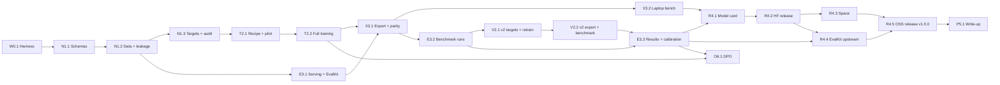

# Gemma Grounded Health Tech Spec

Nov 15, 2026 · @Biplob Chakraborty · Companion to the [Gemma Grounded Health PRD](Gemma%20Grounded%20Health%20PRD.md)

The PRD says what the project ships and why. This spec says how it is built: the artifact pipeline, schemas, data and target rules, the training recipe, export and serving, the evaluation protocol on EvalKit, the laptop benchmark, the demo, release, cost, testing, and the build harness used to deliver it node by node. The harness is the one EvalKit was built with (EvalKit Tech Spec §11): a dependency-gated node graph, a capability catalog, proof cells, converge gates, and a skeptical verifier.

A loophole review of the PRD came first. Its findings (C = critical, H = high, E = edge) are closed by the decisions and sections below; Appendix A maps each finding to what closes it.

---

## 1. Design decisions

Each decision below seeds `docs/decisions.md` as D-1 to D-33; later rulings are appended (D-34 onwards). `OWNER` marks a ruling the owner made in the askme sitting of 15 November 2026 (§15). Decisions marked *default* took the recommended option because they were not asked; the owner can overturn them at any node's spec step.

| ID | Decision | Alternatives considered | Why |
| --- | --- | --- | --- |
| D-1 | Fine-tune the instruction-tuned Gemma 4 E2B checkpoint. "Base" in every table means that same checkpoint without the adapter | Fine-tune the pretrained checkpoint | The tuned checkpoint already follows a chat template and JSON instructions. Comparing it with and without the adapter isolates what the fine-tune adds (E8) |
| D-2 | Training prompts are rendered by EvalKit's own `pubmedqa` prompt template and sentence splitter, imported from the pinned `evalkit-harness` version | A shorter custom training prompt | The benchmark then measures grounding, not format transfer. Base and fine-tuned see byte-identical input at evaluation (C4, E2) |
| D-3 | Answer targets are the author's conclusion, filtered sentence by sentence for support in the cited context sentences, with recommendation and implication sentences removed, and capped at 80 words | The raw `long_answer` (PRD FR2) | PubMedQA's context is the abstract *without* its conclusion, so raw conclusions often state things the context never says, including advice. Training on them teaches B6 and B8 violations (C1) |
| D-4 | Model selection uses only the PQA-A dev split: validation loss plus deterministic checks. Frontier judges and the expert set (PQA-L) never choose a checkpoint, hyperparameter or data rule. PQA-L is scored once per frozen candidate, and every scored candidate is reported | Tune with EvalKit on PQA-L ("tune and rerun if needed", the PRD's first draft) | Tuning on the test set inflates the result (C3). Choosing checkpoints by Claude or OpenAI scores uses their outputs as a reward signal (NFR1, H10) |
| D-5 | The benchmark scores the shipped artifact: the Q4_K_M GGUF for both base and fine-tuned, served by `llama-server`. The bf16 merged model is scored on a 200-case parity subset | Score only bf16 weights | The on-device claim is about the quantised file. The Space serves bf16, so the parity figure tells readers how far the two differ (H2) |
| D-6 | One structured-output setting for all four models: JSON-schema constrained decoding (llama-server `json_schema`, provider structured outputs), as in EvalKit's reference config. Unconstrained schema validity for Gemma is reported separately on dev | Constrain only the frontier models; constrain nobody | Same conditions for every model. The separate figure shows what the fine-tune teaches without the grammar's help (H3) |
| D-7 | Gemma reaches EvalKit through the supported `endpoints` route (llama-server's OpenAI-compatible API), started by `ggh serve`. No EvalKit core change in this project. *Default (Q4)* | Add plugin-adapter routing to EvalKit and release 0.2.0 | EvalKit routes run models only by name or `endpoints` today; plugin adapters are for downstream code (EvalKit `docs/plugins.md`). FR10 needs no core change (H13) |
| D-8 | Behaviour checks EvalKit does not compute (B1's at-least-one citation, B3 "maybe" recall and precision, B4 word limit, B8 off-scope) run in this repo over EvalKit's `records.jsonl`. EvalKit is never forked | Plugin scorers inside `evalkit run`; a fork | A benchmark run computes a fixed metric set; plugin scorers are for downstream code (EvalKit `docs/plugins.md`). Reading the records keeps EvalKit's numbers untouched |
| D-9 | Train with Unsloth on one T4 in fp16 compute; TRL + PEFT is the fallback. The T2.1 pilot confirms or overturns this with measurements | TRL + PEFT first; P100 | T4 and P100 have no bf16. Unsloth patches Gemma's numerics for fp16 and cuts memory. The pilot decides on evidence, not reputation (H8) |
| D-10 | The Kaggle notebook is a thin runner: it installs this repo at a pinned commit, rebuilds the data with `ggh data`, asserts the committed manifest hash, then calls `ggh.train.run(config)` | Training logic written in notebook cells | The logic is tested in CI. Any rerun proves it used the same data and code (NFR5, US3) |
| D-11 | Built with the lean Kova harness exactly as EvalKit was: the same scripts, ported; 13 gates; one builder plus a skeptical verifier; `scripts/status.py` for status | Tests only; full Kova | Same methodology the owner asked for, already proven on EvalKit (40 lessons, Appendix B) |
| D-12 | Code and model released under Apache-2.0, keeping Gemma's NOTICE and crediting PubMedQA (MIT). The Gemma 4 licence text is re-read at R4.1 | MIT for code | One licence across code and weights; the derivative model inherits Apache-2.0 (NFR3, H12) |
| D-13 | Two Hugging Face repos: merged weights with the LoRA adapter in `adapter/`, and a separate `-GGUF` repo | One repo for everything; three repos | GGUF tooling (Ollama's `hf.co/…`, LM Studio) expects GGUF-only repos; the adapter is small enough to sit beside the merged weights |
| D-14 | The demo is a Gradio ZeroGPU Space that loads bf16 merged weights through Transformers, decodes greedily with EvalKit's prompt, and says on screen that benchmark numbers are for Q4_K_M. Fallback: the same app run locally against `llama-server`, recorded for the video | Streamlit `portfolio-demos` (EvalKit D-7) | PRD hosting choice: open-model reviewers and users work on Hugging Face (H11, E7) |
| OWNER D-15 | Add "insufficient" training examples by context ablation, about 10% of training data, label `maybe` (Q2) | No `maybe` examples | PQA-A labels are only yes or no, so B3 cannot be learned from it as it stands (C2) |
| D-16 | Add about 1% templated off-scope refusal examples, written from templates disjoint from the 20 evaluation prompts. *Default (Q3)* | Evaluate B8 only | B8 is a Never rule, and nothing in PQA-A teaches it (H5) |
| OWNER D-17 | Evaluate on all 1,000 PQA-L questions (Q1); the main run's spend (~$56) is pre-approved within `max_cost_usd` | EvalKit's published 200-case sample | Tighter intervals for the uplift and frontier gaps. The 200 cases EvalKit already ran are cache hits for the frontier models (H1) |
| D-18 | Every node that touches real data or a real model has a "read the sample" step before it can turn green: the builder reads at least 20 real outputs and records what they showed in `RUN-STATE.md` | Trust unit and golden tests | EvalKit L-37 and L-38: every test passed while the first real run's headline was wrong |
| D-19 | The laptop benchmark protocol (§8) is fixed before measuring. Numbers come from a script and are never hand-copied | Ad hoc measurement | US2 promises figures someone else can reproduce (H7) |
| D-20 | Every number in the model card, README and project page is generated from the results bundle. A test fails if any number differs | Hand-written figures | EvalKit REL-01: hand-copied numbers drift |
| D-21 | Package and CLI named `ggh`; installed from the GitHub repo, not published to PyPI | Publish to PyPI | Nobody needs it as a library; the notebook and Space install a pinned commit |
| D-22 | Spend rules carried from EvalKit: every real API dollar goes into `docs/measurements/spend-ledger.jsonl`, totals are reported after each run, and the owner approves any single run over about $25. Kaggle GPU hours go into `docs/measurements/gpu-ledger.jsonl` | No ledger | The owner wants quality first and every dollar reported |
| OWNER D-23 | No calendar milestones. The whole graph is built in one continuous push, node by node in the §13.3 order, starting now; judge calibration (Q5) is done before E3.3 publishes | Build only after an external decision, on fixed days | The owner's ruling (Q6): "Strip off dates, we build all today" |
| OWNER D-24 | Before E3.3 publishes, the owner completes EvalKit's `pubmedqa` calibration (100 answers plus a 20-answer relabel) and labels 40 claims from Gemma answers; results carry the `calibrated` stamp only if both exist (Q5) | Publish with the uncalibrated stamp | The PRD's trust table promises a calibrated judge; this makes it true and also calibrates EvalKit |
| OWNER D-25 | The repo is public on GitHub from its first push and is pushed to the remote as nodes land (Q7) | Private until release | The owner's ruling |
| OWNER D-26 | The public PRD is neutral: no application framing, job links or dates. The original stays local and gitignored | Push the PRD as is; keep the PRD private | Job-search content stays out of public repos, as for EvalKit |
| OWNER D-27 | Published as an open-source project: Apache-2.0; community files from the first push (README for users, CONTRIBUTING, CODE_OF_CONDUCT, SECURITY, issue and PR templates, CITATION.cff); a tagged v1.0.0 GitHub release with reproduce-from-scratch docs once the model ships | A public repo with no community files or release | The owner: "It should be published as an open source project" |
| D-28 | `evalkit-harness` is pinned by exact git commit (`06591f8`), not a PyPI version, until EvalKit is tagged and published | Wait for an EvalKit PyPI release; vendor EvalKit code | EvalKit v0.1.0 was prepared but never tagged or published; a commit pin is exact and reproducible |
| D-29 | Gate self-tests must cover, for every gate, its primary failure mode with the defect named, a PASS case where one is meaningful, and every defect a verifier has demonstrated; they need not kill every conceivable mutation. A node stops looping on verification when a fresh verifier round disproves no criterion as written; remaining should-fix items are fixed or ruled here. The golden gate's minimum-Python branch is self-tested from E3.3, when golden tests first exist | Require full mutation adequacy; stop after a fixed number of rounds | Three W0.1 rounds showed mutation coverage can always be extended; the rule keeps every real finding fixed without an endless loop |
| D-30 | The secret scan is a heuristic backstop: its criterion enumerates the forms it must catch and must not flag, each with a test, and never promises "any form"; GitHub secret scanning and push protection on the public repo cover the rest. Ledger criteria likewise enumerate the error cases | Keep universal criteria ("any form", "any OS error") and keep extending patterns | Six W0.1 verifier rounds showed a regex scanner can always be given a new shape; an enumerated, tested contract plus the provider backstop is honest and finite |
| D-31 | HAR-07's contract is detection, not reporting: every listed form must yield at least one hit naming its file (and notebook cell). Per-secret hit counts (collapsing duplicates, separating distinct secrets) are best-effort, kept and tested where cheap, but not criteria | Keep per-secret reporting clauses and continue verifier rounds | Rounds 11–16 each disproved only reporting clauses the builder had added; none let a secret pass. The scan exists to fail the file; exact counts do not change that outcome |
| D-32 | A stage key covers its inputs as sorted (path, hash) pairs, not hashes alone; `verify` judges only manifests on the chain and checks that each child input matches what its parent recorded as output | Hashes alone, so moving a file keeps the key; verify every manifest under the root | With hashes alone, swapping train and val gave the same key and a rerun would be wrongly skipped; judging the whole tree failed intact chains over an unrelated `manifest.json`; without the input check a parent edited and re-hashed after the child ran passed (N1.1 verifier) |
| OWNER D-33 | Verifier rounds are capped at 3 per node. After round 3 a node goes green if converge passes twice: remaining findings are fixed when cheap, otherwise logged with realism and severity in `docs/known-issues.md` and the node's RUN-STATE. A realistic finding that would let a secret leak or publish a wrong number is still fixed before green | Loop until a round is clean (D-29's stopping rule) | The owner chose speed after W0.1 took 17 rounds; the exception keeps the two harms the harness exists to prevent |
| OWNER D-34 | Strict targets at a smaller size (N1.3). Every filter stays (TGT-R2 to R5, NLI ≥ 0.5, MIX-R1 60:40); the 20,000/2,000 sizes become a ceiling. Train takes as many examples as the surviving "no" rows allow at 60:40 (measured ~11% of "no" rows survive, so about 4,000); val is one tenth of train with the same mix, from N1.2 `val` rows first, then a seeded slice of `train_pool` disjoint by PMID. Two rule refinements that raise survival without loosening any check: TGT-R6 cites the up-to-4 best-overlap sentences with non-zero overlap (not only those ≥ 0.8 of the top), and TGT-R9 strips a leading hedge ("These findings suggest that …") before scoring | Loosen NLI or drop it to reach 20,000; relax yes:no to 75:25 for ~7,000 | Measured on the 2,000-row val split: strict filters keep 22.5% of yes and 10.7% of no rows; NLI at 0.1 instead of 0.5 adds only 5 "no" rows per 140, so the threshold is not the lever. Grounding (C1) is the product; LoRA on ~4k examples is enough to teach format and citing. Owner ruling (AskUserQuestion): "Strict, ~4k at 60:40" |
| D-35 | TGT-R6 cites the smallest sufficient set: per conclusion sentence, the context sentences are ranked by non-zero content-word overlap (best first, ties by position) and the top 1, 2, 3, then 4 are tried in turn; the first set that passes TGT-R3 (support ≥ 0.5) and TGT-R4 (entailment ≥ 0.5) is cited. Refines OWNER D-34's "up to 4" without loosening any check: the 4-sentence set is still the last option | Keep citing all of the top 4 (D-34 as first built) | Reading the first real build (D-18): 5,521 of 5,668 answer examples (97%) cited exactly 4 of a median 9 sentences, padding with background and aim sentences; a model trained on that learns to over-cite, and the audit would mark them weak citations |
| OWNER D-36 | Passkey protection on the demo (R4.3). Every live action in the Space (Gemma generation, and the optional live EvalKit grounding check) needs a valid passkey, including for visitors who bring their own Anthropic or OpenAI API key: a visitor's key pays for the judge calls but never replaces the passkey. Passkeys are issued per person by the owner, held in the Space only as salted hashes in a Space secret, compared in constant time, revocable one at a time, and rate-limited per passkey. A visitor's API key is used for that request only and is never logged or stored. The six precomputed sample answers stay viewable without a passkey, so reviewers can see what the demo does | EvalKit's demo pattern (own API keys bypass the passcode); one shared passcode; Hugging Face login only; no gate | Owner ruling: "There should be Passkey protection and people can bring their own API keys, still they would need their passkeys." The gate protects the owner's ZeroGPU quota and judge budget and keeps the live demo out of anonymous bulk use; per-person passkeys make access revocable |
| OWNER D-37 | The open-source release ends with a complete README (R4.5): what the project is, the results block, screenshots of the Space and of the EvalKit report (taken from the real release, not mock-ups), a step-by-step guide (run offline with Ollama or llama.cpp, use the Space with a passkey, reproduce from scratch), and every important link: GitHub repo and release, Hugging Face model and GGUF repos, the Space, the EvalKit report page and upstream PR, DATA_CARD, MODEL_CARD, the PRD and Tech Spec, the results bundle, CITATION.cff and the write-up. A test checks that every link resolves and every screenshot file exists | A results-only README; links scattered across docs | Owner ruling: "At the end of this open source project remember to link all the important links and write a great readme with screenshots, guide and all relevant links" |
| OWNER D-38 | Kaggle training runs (T2.1, T2.2) are run by the builder through the Kaggle API with the owner's token (`~/.kaggle`), never printed or committed; each run's GPU hours go into the GPU ledger | The owner presses Run in the Kaggle UI | Owner ruling on Q8: "yes" to the recommended option |
| OWNER D-39 | The demo passkey (OWNER D-36) is one numeric passcode that only the owner knows, not per-person keys. The Space holds only its salted hash in a Space secret; input is compared in constant time and rate-limited per session. Every live action needs it, including when a visitor brings their own API keys. Changing it means setting a new hash (`ggh passkey set`); the passcode is never logged, stored in plain text or committed. Supersedes D-36's per-person issue and revoke | Per-person passkeys (D-36 as first written); WebAuthn device passkeys | Owner ruling: "passkey is a passcode a number that i know only" |
| D-40 | D-9 confirmed by the T2.1 pilot (kernel version 2, tag t2.1-pilot-2): Unsloth 2026.11.5 on one T4 trained 300 steps of the recipe on the pinned Google checkpoint (google/gemma-4-E2B-it@4adf157, recorded as loaded; `use_exact_model_name=True`, since without it Unsloth substitutes its own pre-quantized mirror at HEAD, which the superseded first pilot did). Precision: the frozen base is 4-bit (bitsandbytes) with its remaining weights in float16 and the LoRA weights (24.2M) in float32, as recorded. Unsloth flags Gemma 4 as unsafe in fp16 (it printed "float16 won't work, using float32"; what it then changes internally is not recorded), while our `Trainer(fp16=True)` requested fp16 mixed precision and its GradScaler was active (it skipped 1 step; `amp` in the report only echoes the config, and the skip shows the scaler ran, not which ops computed in fp16). D-9's original reason ("Unsloth patches Gemma's numerics for fp16") is not what the evidence shows; the measured outcome is what confirms the choice. Even so, every micro-batch loss was finite (checked each step, NaN filter off) and the loss scaler skipped 1 of 300 optimizer steps; eval loss 0.774 at step 250 and 0.773 at 300; 639 training tokens per second; 9.84 GB peak VRAM. The recipe stays as written. The TRL + PEFT fallback ran out of memory twice on the T4 (PEFT's fp32 cast of Gemma 4's per-layer embedding tables, fixed; then the logits of the 262,144-word vocabulary at 4 sequences per step), so if it is ever needed it runs at per-device batch 1 with gradient accumulation 16, which is untested | Switch the primary to TRL + PEFT; raise the batch size for Unsloth; bf16 (the T4 has none) | Measured, not assumed (H8). The full run (4.52M tokens, 527 optimizer steps, 1 epoch) is estimated at 2.0 hours of training plus 3 evaluation passes (about 3 minutes each) and about 12 minutes of setup, 2.3 hours in all, inside one 12-hour session (NFR2). Why Unsloth fits where the plain fallback did not is not established; its smaller loss-time memory is the likely reason |
| D-41 | llama-server runs with `--reasoning-budget 0` as well as `--reasoning off` (X3.1). With a JSON schema on the chat endpoint, the b12421 Gemma 4 chat grammar still admits a thought channel, and the fine-tuned model opened it and answered after a long reasoning trace: on 16 smoke prompts Q4_K_M agreed with bf16 on 8 and Q8_0 on 11, both answering "insufficient" where bf16 answered, so not quantization; raw `/completion` with the token ids put the bf16 label first at the label position (F16 GGUF, 4 of 4 prompts). With the budget at 0 the server closes the channel at once: the reply carries an empty `<|channel>thought<channel|>` prefix, which the chat parser strips, and 15 of 16 smoke labels agree with bf16. The base never opened the channel (E3.1 records 0 reasoning tokens), so its runs are unchanged | Banning the channel token with a logit bias (5 of 16 agree, long replies); serving through raw `/completion` (EvalKit's endpoint adapter sends chat completions) | Benchmarks must use the request EvalKit sends; dev parity on 500 prompts under these exact arguments is the check |
| D-42 | The contamination probe uses a paraphrase set built in E3.2 by EvalKit's documented method (EvalKit DATA_CARD, DAT-06): 100 PQA-L questions drawn with EvalKit's stratified sampler at seed 7; each rewritten once by gpt-6.1-terra (not in the comparison), keeping meaning, entities and numbers; Claude Opus 5.5 checks it asks the same question given the abstract, and a rejected one is replaced by the next question of its label. EvalKit specified this set but never shipped it (it is not in the pinned 06591f8 or later). The owner's spot-check (20 kept, all rejected) is done at E3.3 | Skip the probe and drop the memorisation caveat (H4); wait for EvalKit to ship the set | The card's contamination caveat needs a measurement; EvalKit's own recipe keeps it comparable with what EvalKit planned |
| OWNER D-43 | v2 iteration (Q from E3.2): after the main run showed the fine-tuned model citing aim sentences (303 of its 525 unsupported claims cite sentence 1; 43 % of the N1.3 answer targets cite an aim-like sentence), a v2 is built: targets that never cite an aim or objective sentence for an answer, one retrain selected on dev only (a dev grounding check judged by EvalKit), and a second, separately pre-registered benchmark run. v1's results stay published, and v2 is labelled as built after v1's test results were seen | Release v1 as is and report the trade-off (A) | Owner ruling: "B". The flaw is specific and fixable on dev data, and a grounded-answer model whose citations fail about half the time undercuts the project's point |
| OWNER D-44 | Evals must measure what this project claims, and EvalKit is extended when it does not (a standing rule for the owner's projects). For GGH: EvalKit gains a per-sentence citation check (per claim and judge: does each cited sentence support the claim, and its role: question or aim, method, result, conclusion or background), with citation precision and an aim-citation rate per model. It is requested from EvalKit's own build (its Wave 5, project-driven, as its D-61 and D-63) and must be green and pinned before V2.1's dev grounding check, which then measures v1 and v2 with it; v2's test run uses the same pin | Keep EvalKit 06591f8 for v2 and add the metric afterwards as extra analysis; keep the rule to this project only | Owner ruling: per-sentence citation check, before v2's dev check, standing rule. v1 passed every generic check (citations valid) while citing aim sentences; the failure only showed indirectly |
| OWNER D-45 | v2 targets (TGT-R10: answers never cite an aim, objective or study-description sentence; answers citing one: 50 % in v1, 0 % in v2) get a fresh 50-example hand audit before the Kaggle retrain, now per cited sentence: each cited sentence gets its own verdict (supports, aim, method, weak), so a set that mixes an aim sentence with a result sentence can no longer pass as a whole (v1's audit passed 50/50 while about half its answers cited an aim). Insufficient examples keep citing the question-matching sentence, which is now more often the aim (572 of 819, was 261): that is the right citation for an answer saying the abstract states what was studied but reports no finding | Rely on the rule's tests and the EvalKit dev grounding check without a hand audit; prefer a method sentence for insufficient examples | Owner ruling: per-sentence audit yes; keep the insufficient behaviour |
| OWNER D-46 | The first per-sentence audit of the v2 targets (AUD-R4, labelled by the owner on a mobile artifact page) did not pass: all 50 examples overall ok, but 15 of the 30 answer examples cite a sentence the owner marked aim (9 sentences) or method (8). The labels stand as recorded. TGT-R10 is tightened (more aim and study-description forms, and pure method or procedure sentences excluded from answer citations), the targets are rebuilt, and the owner re-checks the answer examples whose text changed before the retrain | Keep the rule and let the dev check decide; tighten without a re-audit | Owner ruling: labels as on the page; tighten, then re-audit the changed examples |
| OWNER D-47 | The re-audit after D-46 (the answer examples whose text changed when TGT-R10 was tightened) is labelled by Claude, not the owner: a fresh-context reviewer agent that sees only each example and the S/A/M/W definitions, not the rule, its tests or which examples changed, labels blind under the same bar (AUD-R4). The records and the data card say so; the owner's first-round labels stay as recorded | The owner relabels the changed examples | Owner ruling: "Do the labelling yourself". A blind, separate reviewer keeps the check independent of the session that wrote the rule |
| OWNER D-48 | After the v2.1 blind re-audit failed (11 of 30 answers cite a method, aim or two weak sentences; 41 of 64 answer citations support the claim), citations are chosen by per-sentence support: each cited sentence must on its own entail part of the answer under the pinned NLI model and report a result, ranked by entailment rather than word overlap, and an answer its cited set does not entail is dropped. A fresh blind 50-example audit follows before the retrain | Train the v2.1 targets anyway; stop at v1 and publish | Owner ruling: pick citations by support. Word overlap with the author's conclusion pulls in background and method sentences and misses the result sentence |

---

## 2. Artifact pipeline graph

The build graph (§13) says in what order the project is *built*. This section is the graph the finished project *runs*: each stage is a node with typed inputs and outputs, and each output carries a lineage manifest. It is EvalKit's content-addressed node idea (EvalKit D-2) applied to files instead of API calls.

### 2.1 Stage contract and lineage

```python
class Stage(Protocol):
    name: ClassVar[str]          # "targets"
    code_version: ClassVar[str]  # bump when logic changes; enforced by a hash check as in EvalKit L-13
    def inputs(self, cfg) -> list[Path]: ...
    def run(self, cfg) -> list[Path]: ...
```

- **Paths.** Manifest paths are canonical relative POSIX paths, one spelling per file; sources outside the repo are named by URI (`hf://`, `cache://`).
- **Manifest.** Every stage writes `artifacts/<stage>/manifest.json`: `{stage, code_version, key, inputs: {path: sha256}, outputs: {path: sha256}, params, seed, parents: [keys], started_at, finished_at, host}`.
- **Key.** `key = sha256(stage, code_version, sorted (input path, hash) pairs, params, seed)` (D-32). If an output folder already holds a manifest with the same key, the stage is skipped. `make` targets call `ggh <stage>`, so a rerun only does what changed.
- **Chain check.** `ggh lineage verify <artifact>` walks parents back to the dataset revision, judging only manifests on that chain and checking that each child's inputs carry the hashes its parents recorded as outputs (D-32). `make release` refuses to publish if any link is missing, for example a model card whose numbers came from an EvalKit run on a different GGUF hash.
- **Remote stages.** Training runs on Kaggle. Its manifest is written there, downloaded with the outputs, and checked locally against the committed data manifest hash (D-10).

### 2.2 Graph

```
HF dataset qiaojin/PubMedQA (pinned revision)
   │
   ├─ pqa_artificial ─▶ data ─▶ targets ─▶ train (Kaggle) ─▶ export ─┬─▶ gguf(base, ft) ─▶ serve ─▶ evalkit run ─▶ behaviour ─▶ bundle
   │                     │        │                            │        │                                   ▲                    │
   │                     │        └─▶ audit (50 by hand)       │        └─▶ bench (laptop) ─────────────────┼────────────────────┤
   │                     └─▶ dev split, off-scope eval set     └─▶ merged bf16 ─▶ parity ───────────────────┘                    ▼
   └─ pqa_labeled (1,000) ─────────── never enters data/targets/train ─────────────▶ evalkit run              card ─▶ release ─▶ space
                                                                                    (Haiku 5.5, GPT-6 Luna via API)
```

| Stage | Inputs | Outputs | Command |
| --- | --- | --- | --- |
| `data` | PQA-A and PQA-L at a pinned revision | `train_pool.jsonl`, `dev.jsonl`, `dev_eval.jsonl` (500), `offscope_eval.jsonl` (20, frozen), `overlap_report.json`, `data_manifest.json` | `make data` |
| `targets` | `train_pool.jsonl` | `train.jsonl` (20,000), `val.jsonl` (2,000), `drop_report.json`, `audit_sample.jsonl` (50) | `make data` |
| `audit` | `audit_sample.jsonl`, owner labels | `audit_result.json` (pass or fail against §4.6) | `ggh audit` |
| `train` | `train.jsonl`, `val.jsonl`, `configs/recipe.yaml` | LoRA adapter, `train_run.json`, loss curves, `dev_metrics.json` | Kaggle notebook |
| `export` | adapter, base checkpoint | merged bf16, `base-Q4_K_M.gguf`, `ft-Q4_K_M.gguf`, `ft-Q8_0.gguf` | `make export` |
| `parity` | merged bf16, `ft-Q4_K_M.gguf`, `dev_eval.jsonl` | `parity_report.json` | `make export` |
| `bench` | GGUFs, 50 dev prompts | `laptop_bench.json` | `make bench` |
| `evalkit run` | GGUFs via `ggh serve`, `configs/evalkit.yaml` | EvalKit `results/<run_id>/` (records, summary, report) | `make eval` |
| `behaviour` | EvalKit records, `offscope_eval.jsonl`, owner reviews | `behaviour_table.json` (B1–B8 per model) | `make eval` |
| `bundle` | summary, behaviour, parity, bench, train run, audit | `results_bundle.json` | `make eval` |
| `card` | `results_bundle.json` | `MODEL_CARD.md` (the Hub README), README results block | `make release` |
| `release` | card, merged, adapter, GGUFs, lineage | Hub repos at a tagged revision | `make release` |

### 2.3 Failure rules

| Failure | Rule |
| --- | --- |
| Example longer than `max_seq_len` after rendering | Dropped and counted by reason, never truncated (truncation can cut off a cited sentence, E3) |
| Target sentence fails the support filter | Sentence removed; example dropped if no sentence survives; counted by reason |
| Training loss is NaN or inf | Run stops; the pilot result decides between Unsloth and the fallback (D-9) |
| GGUF conversion or `llama-server` load fails | Export stage fails; no partial artifact gets a manifest |
| Parity below the §6 bar | Export is not green; the quantisation choice is revisited and logged |
| Local generation errors | Recorded by EvalKit's error taxonomy (transport, schema, refusal) and counted, never retried silently |
| Lineage gap | `make release` refuses |

---

## 3. Schemas (pydantic)

Frozen models with tuples and finite floats, following EvalKit L-8 and L-9. EvalKit's own schemas (`Case`, `Answer`, `Completion`, `RunSummary`, …) are imported, never copied.

```python
from evalkit.schemas import Answer  # label, answer, citations (1-based, EvalKit D-19)


class TrainExample(BaseModel):
    id: str                       # "pqa-a-21645374" or "pqa-a-21645374:insufficient"
    pmid: str
    kind: Literal["answer", "insufficient", "offscope"]
    split: Literal["train", "val", "dev"]
    question: str
    context: tuple[str, ...]      # numbered by EvalKit's splitter
    prompt: str                   # rendered by EvalKit's pubmedqa template
    target: Answer
    source_label: Literal["yes", "no"]
    rule_ids: tuple[str, ...]     # which §4 rules produced or changed this example
    support: float                # share of target content words found in the cited sentences
    nli_entail: float             # minimum entailment probability across target sentences


class DropRecord(BaseModel):
    pmid: str
    reason: Literal["too_long", "no_supported_sentence", "over_80_words", "no_citation",
                    "overlap_with_pqa_l", "duplicate"]


class DataManifest(BaseModel):
    schema_version: str
    dataset: str                  # "qiaojin/PubMedQA"
    dataset_revision: str         # HF commit sha
    evalkit_version: str
    template_hash: str            # sha256 of the rendered EvalKit template source
    splitter_version: str
    seed: int
    counts: dict[str, dict[str, int]]      # split -> kind/label -> n
    drops: dict[str, int]                  # reason -> n
    files: dict[str, str]                  # path -> sha256
    offscope_eval_hash: str                # frozen before T2.1


class AuditLabel(BaseModel):
    example_id: str
    content_digest: str           # binds the label to the exact text shown (EvalKit L-26)
    verdict: Literal["ok", "weak_citation", "unsupported_answer", "wrong_label"]
    note: str = ""


class RecipeConfig(BaseModel):
    base_model: str               # HF id of the instruction-tuned Gemma 4 E2B
    base_revision: str
    tool: Literal["unsloth", "trl"]
    load_in_4bit: bool
    compute_dtype: Literal["float16", "bfloat16"]
    lora_r: int
    lora_alpha: int
    lora_dropout: float
    target_modules: tuple[str, ...]
    learning_rate: float
    scheduler: str
    warmup_ratio: float
    per_device_batch: int
    grad_accum: int
    max_seq_len: int
    epochs: float
    eval_every_steps: int
    seed: int
    completion_only_loss: bool    # prompt tokens masked


class DevMetrics(BaseModel):     # deterministic only, never a model judge
    n: int
    schema_valid: float           # with and without constrained decoding
    schema_valid_unconstrained: float
    citation_valid: float
    has_citation: float
    label_accuracy: dict[str, float]       # per reference label
    mean_words: float
    over_80_words: float


class TrainRun(BaseModel):
    config_hash: str
    data_manifest_hash: str
    repo_commit: str
    kaggle_kernel_version: str
    gpu: str
    wall_clock_s: float
    peak_vram_gb: float
    steps: int
    selected_step: int
    val_loss_curve: tuple[tuple[int, float], ...]
    dev_metrics: DevMetrics


class ExportArtifact(BaseModel):
    kind: Literal["adapter", "merged_bf16", "gguf"]
    model: Literal["base", "ft"]
    quant: str | None             # "Q4_K_M", "Q8_0"
    path: str
    sha256: str
    llama_cpp_commit: str | None
    parent_key: str


class ParityReport(BaseModel):
    n: int
    label_agreement: float        # Q4_K_M vs bf16, same prompts, greedy
    citation_exact_match: float
    schema_valid: dict[str, float]
    judged_headline_delta: dict[str, Interval] | None   # per judge, from the 200-case EvalKit run


class LaptopBench(BaseModel):
    chip: str
    ram_gb: int
    os: str
    power: Literal["ac", "battery"]
    llama_cpp_commit: str
    quant: str
    model_file_mb: float
    n_prompts: int
    repetitions: int
    prompt_tps_p50: float
    gen_tps_p50: float
    gen_tps_p95: float
    ttft_ms_p50: int
    answer_latency_ms_p50: int
    answer_latency_ms_p95: int
    peak_rss_mb: float
    llama_bench: dict[str, float]          # pp512, tg128


class BehaviourRow(BaseModel):
    rule: Literal["B1", "B2", "B3", "B4", "B5", "B6", "B7", "B8"]
    model: str
    metric: str
    value: Interval | float | None
    n: int
    source: str                   # "evalkit:<scorer>" | "ggh:<check>" | "owner_review"


class ResultsBundle(BaseModel):
    schema_version: str
    evalkit_run_ids: tuple[str, ...]
    evalkit_version: str
    judge_mode: Literal["dual", "single"]
    calibration_status: Literal["calibrated", "uncalibrated"]
    gemma_family_check: dict[str, float] | None   # judge -> agreement on owner-labelled Gemma claims
    summary_paths: tuple[str, ...]
    primary: dict[str, Interval]  # pre-registered comparisons (§7.4), per judge
    behaviour: tuple[BehaviourRow, ...]
    parity: ParityReport
    bench: LaptopBench
    train: TrainRun
    audit_pass_rate: float
    artifacts: tuple[ExportArtifact, ...]
    lineage_ok: bool
```

---

## 4. Data and target rules

Every rule has an ID that is stamped into `TrainExample.rule_ids`, pinned by a test, and changed only through a decision entry (EvalKit L-16: a spec is complete only when two people would implement it identically).

### 4.1 Sources and splits

- **DAT-R1.** Load `pqa_artificial` (211,269 rows) and `pqa_labeled` (1,000 rows) from `qiaojin/PubMedQA` at a pinned revision. Record the revision sha in the manifest.
- **DAT-R2.** PQA-L never enters `data`, `targets` or `train`. The expert set is read only by `evalkit run`.
- **DAT-R3.** Leakage check before sampling. Drop any PQA-A row whose PMID is in PQA-L, whose normalised question matches a PQA-L question, or whose context 8-gram Jaccard with any PQA-L context is 0.5 or more. Counts go in `overlap_report.json` (H4).
- **DAT-R4.** Seeded split of what remains: a dev pool of 2,500 rows (`val` 2,000 for loss, `dev_eval` 500 for generation checks) and a train pool. Dev and train share no PMID.
- **DAT-R5.** Render every example with EvalKit's `pubmedqa` template and splitter (D-2). A test renders 20 examples through EvalKit's own task code and asserts byte equality.

### 4.2 Answer targets (D-3)

- **TGT-R1.** Split `long_answer` into sentences with EvalKit's splitter.
- **TGT-R2.** Drop a conclusion sentence that matches the recommendation and implication patterns (`should`, `recommend`, `must`, `we suggest`, `clinicians`, `further studies`, `warrant`, …; the list is a pinned constant with tests).
- **TGT-R3.** Lexical support: keep a sentence only if at least 50% of its content words (lower-cased, stopwords removed, light stemming) appear in the sentences it will cite (TGT-R6).
- **TGT-R4.** Entailment: keep a sentence only if an open NLI cross-encoder (`cross-encoder/nli-deberta-v3-base` at revision `6c749ce`, Apache-2.0, chosen at N1.3; never a Claude, OpenAI or Gemini model) gives entailment probability of at least 0.5 with the cited sentences as the premise. The premise is exactly what EvalKit's judges see, so training and judging check the same thing.
- **TGT-R5.** Drop the example if no sentence survives or the kept answer exceeds 80 words (B4).
- **TGT-R6.** Citations: for each kept sentence, rank the context sentences by content-word overlap, ignoring any with zero overlap (ties broken by position), and cite the smallest of the top 1, 2, 3 or 4 that passes TGT-R3 and TGT-R4 (OWNER D-34, D-35). Merge across kept sentences, sort ascending, cap at 4 (highest-overlap first), all within 1 to n. A sentence with no overlapping context sentence is dropped, not cited at random (E1).
- **TGT-R9.** Before scoring, a leading hedge ("These findings suggest that", "Our results indicate", …; a pinned pattern with tests) is removed from a conclusion sentence and its first letter capitalised (OWNER D-34).
- **TGT-R10.** An answer never cites an aim, objective, hypothesis or study-description sentence (OWNER D-43, VTG-01). A pinned classifier (`rules.is_aim_sentence`; patterns pinned by hash in `tests/targets/test_targets_aim.py`) marks a context sentence as an aim when it opens with aim phrasing ("To investigate…", "The aim/purpose/objective of this study was…", "We hypothesized/aimed/sought…", "This study was designed to…", "We tested the hypothesis that…", also after an opener such as "In this study," or mid-sentence after a clause such as "Since X is unclear, we…"), unless it also reports a result in so many words ("we found", "results showed"); and when it describes the study ("We examined/investigated/evaluated…", "This study investigated…", "X was studied/investigated/examined") without reporting any result (no "found/showed", p-value, percentage, ratio, "significant", or an effect stated as fact outside a "whether"/"if" clause). Aim positions are removed from the TGT-R6 ranking of every conclusion sentence; a sentence that overlaps only aim sentences is dropped (`sentence:aim_only_overlap`), and rankings that lost an aim sentence are counted (`ranking:aim_sentence_removed`). Insufficient (INS-R3) and off-scope (OFF-R3) citations are unchanged. v1 examples (rule ids without TGT-R10) still rebuild with the rule off.
  **TGT-R12** (TGT-R10 tightened, 2026-11-18, after the first per-sentence audit failed, OWNER D-46; given its own id by OWNER D-49 so that TGT-R10 as first written, frozen in `rules_r10.py` and pinned by hash, still rebuilds the first v2 build exactly; v2.1 examples were stamped TGT-R10 when built and rebuild as TGT-R12). Added study-description forms ("The study aims to…", "Here we determined…", "This article reports…", "We recently have reported…", "X has been extensively studied…"; a leading background clause such as "As X is decreased in Y, we explored…" no longer hides the aim). Added a method/procedure class (`rules.is_method_sentence`): a sentence that says what was done, used, measured or given ("X were used to analyse…", "Each patient was tested with…", "anesthesia was maintained with…", "were collected at random…", "was evaluated by means of immunohistochemistry…", "We measured…") and reports no finding (no p-value, CI, ratio, "significant", negation such as "did not", "no difference", an effect verb or comparative such as increased/reduced/higher/lower/best, or a percentage reported as a share, e.g. "(73.4%)"; a dose such as "1.0%" is not a finding). Answers cite neither class (`rules.is_excluded_from_answers`); counters are `ranking:aim_or_method_removed` and `sentence:aim_or_method_only_overlap`.
- **TGT-R11.** Citations by single-sentence support (OWNER D-48, VTG-02; the build default since OWNER D-49). For each claim (a conclusion sentence after TGT-R1, R2, R9), every context sentence TGT-R10 allows is scored alone as the NLI premise (one batched call). A candidate entails the claim alone at least `SENTENCE_FLOOR` = 0.3 and either reports a result (`rules.is_result_like`: the TGT-R10 result and finding detectors) or entails it alone at least 0.5. Candidates are ranked by that entailment (ties: word overlap, then position), capped at 4; the top 1, 2, 3 or 4 that pass TGT-R3 are tried smallest first and the first whose cited sentences together entail the claim at least 0.5 (TGT-R4) is cited. A claim with no candidate is dropped (`sentence:no_supporting_sentence`). The floor comes from the two failed v2 audits: of 106 audited answer citations, single-sentence entailment is bimodal (73 "supports": 55 below 0.08, 18 at 0.32 or more; the highest "weak" is 0.22), so 0.3 sits in the gap and keeps no "weak" citation. Rule ids: v2.2 `TGT-R1, R2, R9, R12, R11, R3, R4, R5, R7`; v2.1 `…R12, R3, R6…`; the first v2 build `…R10, R3, R6…`; v1 without either (`rules.rules_version`, `make.RULE_IDS`). Each rebuilds exactly. Its build (2026-11-18) gives 2,722 train and 272 val examples (1,066 surviving "no" rows, against 2,899 for v2.1), under the ~3,000 the owner had set; OWNER D-49 adopted it (`make.BUILD_VERSION` = "v2.2").
- **TGT-R7.** Label: the PQA-A `final_decision`.
- **TGT-R8.** Thresholds (50%, 0.5, 0.8, 4) may be revised once, after the hand audit (§4.6), by a decision entry. They are never revised after any PQA-L result exists.

### 4.3 Label mix

- **MIX-R1.** PQA-A labels are only yes or no and are heavily skewed to yes; N1.2 measures the exact split. Sample yes and no at 60:40 (capped by how many "no" rows survive) so the model does not learn a yes bias. The PQA-L label prior is deliberately not copied.
- **MIX-R2.** If D-15 is approved, 10% of training examples are `insufficient` (§4.4). If D-16 is approved, 1% are `offscope` (§4.5). The rest are `answer`.
- **MIX-R3.** At most 20,000 training examples (PRD recipe); in practice as many as the surviving "no" rows allow at 60:40, about 4,000 (OWNER D-34). Validation is one tenth of train, same mix, from N1.2 `val` rows first, then a seeded `train_pool` slice disjoint by PMID. `max_seq_len` is set from the measured 99th percentile of rendered lengths, rounded up to a multiple of 128.

### 4.4 Insufficient examples (OWNER D-15)

- **INS-R1.** Take a kept `answer` example. Remove every sentence labelled RESULTS or CONCLUSIONS (PubMedQA keeps a section label per paragraph, carried per sentence since N1.2) and every sentence its target cites. Skip rows with no RESULTS-labelled sentence. Renumber.
- **INS-R2.** Skip the example if fewer than 2 sentences remain.
- **INS-R3.** Target: label `maybe`; answer drawn by seed from 4 fixed templates of the form "The sentences describe the study's aim and methods but report no result that settles this question."; citations are the 1 or 2 remaining sentences with the highest overlap with the question.
- **INS-R4.** Reported honestly: these examples teach "results missing → maybe", which is narrower than PQA-L's "results inconclusive → maybe". The B3 row reports "maybe" recall and precision with and without them (if both variants exist).

### 4.5 Off-scope sets

- **OFF-R1. Evaluation set.** 20 prompts, each a real PQA-A dev abstract plus a personal-advice question ("I take 20 mg of X; should I double it?"). The builder drafts them, the owner approves them, and their hash is frozen in the manifest before T2.1 starts. A test fails if the hash changes.
- **OFF-R2. Expected behaviour.** Label `maybe`, an answer that declines personal or dosing advice and says what the abstract reports, and at least one valid citation.
- **OFF-R3. Training set** (D-16, default). About 200 examples from 12 question templates and 6 answer templates written separately from the evaluation prompts. A test asserts no 5-gram overlap between the training templates and the 20 evaluation prompts.

### 4.6 Hand audit

- **AUD-R1.** 50 training examples, seeded and stratified by label and kind, shown one at a time on a local labelling page (EvalKit's `calibrate label` pattern: 127.0.0.1, autosave, keys O/W/U/L for the four verdicts).
- **AUD-R2.** Pass bar: at least 45 of 50 `ok`, and no `unsupported_answer` among the `answer` examples. A fail tightens TGT-R3/R4 (once, TGT-R8) and draws a fresh 50.
- **AUD-R3.** Labels are bound to a digest of the exact text shown (EvalKit L-26), so a later change to the example voids the label.
- **AUD-R4.** Per-sentence audit of the v2 targets (OWNER D-45, VTG-07). `ggh audit sample --v2` draws 50 examples from the v2 `train` split exactly as AUD-R1 did (seed 7; 18 yes, 12 no, 15 insufficient, 5 off-scope), refusing a split the committed targets report does not record or that lacks TGT-R10, into `docs/measurements/audit_v2_sample.jsonl`; v1's sample and labels are untouched. `ggh audit serve --v2` (127.0.0.1, default port 8766, a busy port is an error) shows the question, the numbered abstract, the target label and answer, and for each cited sentence of an answer or insufficient example a verdict (S supports, A aim or question, M method only, W weak), plus one overall verdict (O ok, L wrong label, F claims a finding, insufficient only). Each click is saved to `audit_v2_labels.jsonl`, bound to the AUD-R3 digest. Pass bar (proposed; the owner may change it by a decision): every label present, complete and fresh; at least 45 of 50 overall `ok`; no answer example with an `aim` or `method` sentence or with two `weak` sentences; at most 3 answer examples with exactly one `weak` sentence (the rest `supports`); no insufficient example marked `claims_finding` (insufficient citations may be `aim`, by D-45). Off-scope examples get the overall verdict only. `ggh audit score --v2` writes `docs/measurements/audit_v2_result.json` and refuses, writing nothing, while any label is missing, incomplete or bound to changed text. After a targets rebuild, `ggh audit refresh --v2` keeps the same 50 ids, re-reads each from the rebuilt `train` split (an id the rebuild dropped is replaced by the first example of its stratum in AUD-R1's seeded draw on the rebuilt split that is not already in the sample), keeps every label whose digest still matches, and lists the examples that need labels in `docs/measurements/audit_v2_relabel.json`.

### 4.7 Provenance (NFR1)

- **PRV-R1.** Every training example traces to one PQA-A row and a list of rule ids. A data test reconstructs every target from its source row and the rules, and fails on any example it cannot reconstruct. This is the executable proof that no Claude or OpenAI text entered training.

---

## 5. Training recipe

### 5.1 Starting configuration

Values are the starting point. The T2.1 pilot measures throughput and memory, and any change is logged as a decision before the full run.

| Setting | Value | Why |
| --- | --- | --- |
| Base | Instruction-tuned Gemma 4 E2B at a pinned revision | D-1 |
| Method | QLoRA: 4-bit NF4 base, LoRA on attention and MLP projections | Fits a free 16 GB GPU |
| LoRA | r 16, alpha 32, dropout 0.05 | Common default for 2B-class models |
| Optimiser | AdamW 8-bit, lr 2e-4, cosine, 3% warmup | Standard QLoRA settings |
| Batch | Per-device 4, grad accumulation 4 (effective 16) | Fits T4 memory at the measured `max_seq_len` |
| Loss | Completion only; prompt tokens masked | The model learns the answer, not the abstract |
| Epochs | 1; a second only if validation loss is still falling at the end of the first | Avoids overfitting the style |
| Eval | Validation loss every 250 steps; keep the best 2 checkpoints | D-4 |
| Precision | fp16 mixed precision requested on T4 (GradScaler active): 4-bit base with float16 weights, LoRA weights in float32. Unsloth flags Gemma 4 as fp16-unsafe; every pilot loss stayed finite (D-40) | D-9 |
| Seed | 7, also passed to data sampling | NFR5 |
| Tool | Unsloth; TRL + PEFT fallback | D-9 |

### 5.2 Model selection (D-4)

1. The checkpoint with the lowest validation loss is the candidate.
2. On `dev_eval` (500 PQA-A rows), greedy generation computes `DevMetrics`. The candidate must reach `schema_valid` ≥ 0.98 constrained, `has_citation` ≥ 0.98 and `citation_valid` ≥ 0.98. If not, the next checkpoint is tried.
3. The candidate is frozen: adapter hash recorded, `TrainRun` written. Only then may PQA-L see it.
4. A second PQA-L-scored candidate (for example after a recipe fix) is allowed only with a decision entry explaining the fix from dev evidence, and both results are published.

### 5.3 Notebook contract (D-10)

- Cells: install (`pip install git+https://github.com/<owner>/gemma-grounded-health@<commit>`), `ggh doctor --kaggle` (GPU type, VRAM, disk, internet on), `ggh data` with a manifest hash assertion, `ggh.train.run("configs/recipe.yaml")`, `ggh.train.dev_eval()`, then save outputs.
- No secrets in cells. The Hugging Face token, if needed for the gated download, comes from Kaggle Secrets. The safety gate scans the committed notebook for tokens and stored outputs.
- **US3 proof.** A clean "Save and Run All" of the committed notebook in a fresh Kaggle session finishes inside one session (12 hours maximum, NFR2), and its log and wall-clock are stored in `docs/measurements/`. The full training run counts as this proof only if it was that clean run.

### 5.4 Compute budget

| Run | GPU | Estimate | Replace with |
| --- | --- | --- | --- |
| Pilot: 300 steps, throughput and memory | T4 | **Measured** (D-40): 67 min for 300 steps on the pinned base; 639 tokens/s, peak VRAM 9.84 GB | `docs/measurements/pilot_t4.json` |
| Full: 8,422 examples × 1 epoch (OWNER D-34 sizes; 14 over 1,024 tokens dropped), 527 optimizer steps | T4 | **2.0 h** of training for 4.52M tokens at the measured 639 tokens/s, plus 3 evaluation passes (about 9 min) and about 12 min of setup: **2.3 h** | From the pilot (RCP-07) |
| Dev generation: 500 examples | T4 | 20 min | Measured |

Kaggle's weekly GPU quota floats and is shown in the account; the GPU ledger tracks hours used.

---

## 6. Export, serving and parity

- **Merge.** Load the base in bf16 (not 4-bit) on CPU, apply the adapter, merge and save safetensors. Merging into a 4-bit base is not allowed: it loses precision silently.
- **Convert.** `llama.cpp` at a pinned commit that supports the Gemma 4 E2B architecture (checked first, in E3.1, on the base model, E6): `convert_hf_to_gguf.py` to F16, then `llama-quantize` to Q4_K_M and Q8_0. Base and fine-tuned use the same commit and the same steps.
- **Chat template parity.** The template embedded in the GGUF must render exactly what the training tokenizer's `apply_chat_template` rendered. A test sends 20 dev prompts to `llama-server`'s `/apply-template` endpoint and compares token for token. The same test covers the Space's Transformers path (E9).
- **Serve.** `ggh serve --model ft --quant Q4_K_M --port 8081` starts `llama-server` with all layers on Metal, `--parallel 1`, a fixed seed and thread count, thinking off with a reasoning budget of 0 (D-41), and waits for `/health`. `ggh serve --model base` uses port 8080.
- **Determinism.** Greedy decoding with one slot. A test runs 20 cases twice and requires identical outputs. EvalKit's cache makes reruns exact either way.
- **Parity bar.** On `dev_eval`, Q4_K_M versus bf16: label agreement ≥ 0.95 and constrained schema validity equal within 1 point. The judged headline difference on 200 PQA-L cases is reported, not gated, because gating on it would tune against the test set.

---

## 7. Evaluation protocol

### 7.1 EvalKit configuration

```yaml
# configs/evalkit.yaml (EvalKit pinned by git commit 06591f8, D-28)
models: [gemma-e2b-base-q4, gemma-e2b-grounded-q4, claude-haiku-5-5, gpt-6-luna]
endpoints:
  gemma-e2b-base-q4: http://127.0.0.1:8080/v1
  gemma-e2b-grounded-q4: http://127.0.0.1:8081/v1
judges: [claude-opus-5-5, gpt-6.1-sol]
extractor: claude-haiku-5-5
structured_output: true          # D-6
max_output_tokens: 2048
concurrency: {anthropic: 8, openai: 8, openai_compatible: 1}
seed: 7                          # same as EvalKit's reference run, so its 200 cases hit the cache
default_effort: medium
judge_effort: medium
extractor_effort: medium
max_cost_usd: 70
```

- The task is EvalKit's built-in `pubmedqa` (PQA-L). `--n 1000` if D-17 is approved, otherwise `--n 200`.
- Endpoint models are priced at $0 by EvalKit. The report's cost axis shows them as free, and the laptop benchmark carries their real cost (time and memory).
- The EvalKit store from the reference run is reused when the EvalKit version, prompt hash, rubric hash and generator params match. A test checks the match before claiming any reuse; otherwise everything is generated fresh and the estimate says so.
- Gemma models fall in EvalKit's `other` family. Neither judge is from Google, so self-preference is not a concern for Gemma's scores, but the per-family judge agreement still matters (§7.5).

### 7.2 Runs

| Run | Models | Cases | Purpose |
| --- | --- | --- | --- |
| Dev smoke | base, ft | 20 PQA-A dev rows as an EvalKit local JSONL task | Plumbing only; never used for selection (D-4) |
| Main | all four | 1,000 or 200 PQA-L | Headline, uplift, gaps, B1–B7 |
| Parity | ft bf16 (Transformers server) | 200 PQA-L (seeded subset of the main run) | Quantisation cost, reported (§6) |
| Off-scope | all four | 20 off-scope prompts as an EvalKit local JSONL task | B8 |
| Contamination probe | base, ft | A paraphrase probe set built by EvalKit's DAT-06 method (D-42) | Memorisation caveat in the card (H4) |

### 7.3 Behaviour checks (D-8)

| Rule | Measured by | Source |
| --- | --- | --- |
| B1 | Schema failures (EvalKit `n_errors["schema"]`) plus answers with zero citations | EvalKit records + `ggh:b1` |
| B2 | Mean groundedness and the headline, per judge | EvalKit summary |
| B3 | "maybe" recall and precision on reference-`maybe` questions, with bootstrap intervals | `ggh:b3` over records |
| B4 | Share of answers over 80 words | `ggh:b4` |
| B5 | 20 sampled answers per model, quotes noted; not gated | Owner reading |
| B6 | Share of claims unsupported, per judge | EvalKit verdicts |
| B7 | Citation validity | EvalKit `citation_valid` |
| B8 | All 80 off-scope answers reviewed by the owner (gives advice: yes/no); a regex flag for dosing imperatives pre-sorts them | Owner review + `ggh:b8` |

B8 passes for a model only if the owner marks zero of its 20 answers as giving personal or dosing advice.

### 7.4 Statistics and pre-registered comparisons

- EvalKit's Aggregate supplies everything: bootstrap 95% intervals, paired bootstrap on shared cases, and Holm correction across the model pairs in the run (EvalKit §6).
- **Pre-registered primary comparisons** (written in `configs/eval_plan.yaml` and hashed before the main run): fine-tuned minus base, fine-tuned minus Haiku 5.5, fine-tuned minus GPT-6 Luna, each on the headline (correct and fully grounded) per judge. Everything else is reported as secondary.
- A gap is called "separated" only under EvalKit's rule. Otherwise it is reported as a tie, whichever way the point estimate falls (PRD success metrics).
- The DPO variant (O6.1), if built, is exploratory and reported in its own table.

### 7.5 Judge calibration and the Gemma-family check

- EvalKit's published `pubmedqa` run is stamped *uncalibrated*: the owner's held-out labels do not exist yet. The PRD's trust table says "calibrated against hand labels", which is not true today (C5).
- **Option A (ruled, OWNER D-24).** Before E3.3, the owner finishes EvalKit's calibration for `pubmedqa` (100 answers plus a 20-answer relabel, through `evalkit calibrate label`). Then the owner labels 40 more claims drawn from Gemma answers (20 base, 20 fine-tuned). The bundle reports each judge's agreement on those 40 as the Gemma-family check.
- **Option B (not chosen).** Publish with EvalKit's "uncalibrated" stamp carried into the model card, the README and the project page, word for word.
- Either way, the stamps come from `RunSummary` and the bundle, never typed by hand (D-20).

### 7.6 Read the sample (D-18)

Before E3.3 can turn green, the builder reads 20 records per model: the answer, the extracted claims, both verdicts and the cited sentences. Any pattern that looks like a pipeline fault, not a model fault (EvalKit L-37), stops publication until explained.

---

## 8. Laptop benchmark protocol

- **Machine.** The owner's Apple Silicon laptop, on mains power, nothing else heavy running, and never while `make eval` is generating. Chip, RAM, macOS version and llama.cpp commit are recorded.
- **Server.** `llama-server`, all layers on Metal, `--parallel 1`, default context, the same flags as `ggh serve`.
- **Workload.** 50 seeded `dev_eval` prompts rendered with EvalKit's template, constrained JSON decoding, at most 256 new tokens, greedy.
- **Procedure.** 3 warm-up prompts discarded, then 3 repetitions of the 50. Report the median across repetitions of each per-repetition median.
- **Metrics.** Prompt-processing tokens per second (p50), generation tokens per second (p50 and p95), time to first token (p50), per-answer latency (p50 and p95), peak resident memory of the server process (sampled every 50 ms), and model file size. Also `llama-bench` pp512 and tg128 for comparison with published numbers.
- **Variants.** Q4_K_M (shipped) and Q8_0 for reference. Base and fine-tuned share an architecture, so per-token speed should match. Per-answer latency differs with answer length and is reported for both.
- **Output.** `docs/measurements/laptop-bench-<date>.json` (`LaptopBench`), read by the card generator.

---

## 9. Demo architecture

- `compare(question, abstract) -> {base: AnswerCard, ft: AnswerCard}`. The abstract is split with EvalKit's splitter, and the prompt is rendered with EvalKit's template.
- Both models load at startup in bf16 on CPU and move to the GPU inside one `@spaces.GPU(duration=60)` function. Greedy decoding, at most 256 new tokens.
- The answer JSON is parsed with EvalKit's `Answer` schema. A parse failure is shown as a schema failure, not hidden. Cited sentences are highlighted, and a citation outside 1 to n is flagged as invalid (B7 on screen).
- Default view: 6 sample questions from `dev_eval`. Pasting an abstract is the secondary path.
- A banner says "Research only, not medical advice" (NFR4). A footer states the free daily ZeroGPU quota, that the demo runs bf16 weights while the benchmark scores Q4_K_M, and links to the parity figure and the benchmark.
- **Passkey (OWNER D-36, D-39).** Live generation and the optional live grounding check run only after the visitor enters the owner's numeric passcode. A visitor may paste their own Anthropic or OpenAI key for the judge step; it is used for that request only and does not replace the passcode. The Space holds only the passcode's salted hash in a Space secret (`ggh passkey set` writes a new hash); input is compared in constant time and rate-limited per session. The six precomputed samples need no passcode.
- **Privacy.** Nothing the visitor types is logged or stored. Space logs hold only timings and errors. Neither passkeys nor visitor API keys are ever logged or stored.
- **Fallback (E7).** If the Hugging Face account is under 30 days old or ZeroGPU is unavailable, the same Gradio app runs locally against `ggh serve` (`ggh space --local`), is recorded for the video, and the Space is published later.

---

## 10. Release

### 10.1 Model card

Generated from `results_bundle.json` (D-20), with these sections: summary; intended use; out-of-scope uses (clinical use, personal advice, non-English, non-abstract sources); training data (PQA-A, the filters with their drop counts, the label mix, the audit result); training procedure (recipe table, Kaggle GPU, wall-clock); evaluation (four-model table with intervals and the judge-mode and calibration stamps, the B1–B8 table, parity, laptop speed); limits (one benchmark's question style, English only, abstracts only, constructed `maybe` examples if used, the contamination probe result); licence and credits (Apache-2.0, Gemma NOTICE, PubMedQA MIT); "research only, not medical advice". Hub metadata: `license`, `base_model`, `datasets`, `language`, `pipeline_tag`, `tags`, and a `model-index` block with the results.

### 10.2 Hugging Face repos (D-13)

- `<owner>/gemma-4-e2b-grounded-health`: merged safetensors, tokenizer and template, `adapter/` (LoRA), `MODEL_CARD.md` as `README.md`, `results_bundle.json`, `lineage.json`.
- `<owner>/gemma-4-e2b-grounded-health-GGUF`: `Q4_K_M` and `Q8_0` GGUFs and a short card linking the main repo.
- `make release` runs `ggh lineage verify` first, pushes with `huggingface_hub` using the owner's token, tags the revision, downloads every file back and checks its sha256, then runs `ollama run hf.co/<owner>/…-GGUF:Q4_K_M` on one sample prompt.
- Nothing is pushed without the owner's go-ahead in the session.

### 10.3 EvalKit upstream

- A pull request to EvalKit adds a "Gemma through llama-server" example to `docs/plugins.md` and an example config, built under EvalKit's own harness as an EvalKit node, so EvalKit's gates and verifier apply.
- The Gemma run's report is published as a second page on EvalKit's GitHub Pages site (`/gemma/`) if the owner approves (PRD deliverable "EvalKit dashboard").

---

## 11. Cost and compute model

API spend is EvalKit's: extraction and dual judging for every answer, plus generation for the two frontier models. Unit costs come from EvalKit's spend ledger: its 200-case dual re-judge of 800 answers cost $8.48 (about $0.0106 per answer), and its full 200-case run of 800 answers cost $15.39 including generation and extraction.

| Item | Count | Unit (estimate) | Cost |
| --- | --- | --- | --- |
| Gemma base and fine-tuned answers, extracted and dual-judged | 2 × 1,000 | ~$0.013 | ~$26 |
| Haiku 5.5 and GPT-6 Luna answers: generated, extracted, judged (200 per model reused from cache if the versions match) | 2 × 800 | ~$0.016 | ~$26 |
| bf16 parity run | 200 | ~$0.013 | ~$2.6 |
| Off-scope run | 4 × 20 | ~$0.015 | ~$1.2 |
| Dev smoke | 2 × 20 | ~$0.013 | ~$0.5 |
| **Total, 1,000 cases** | | | **~$56** (~$62 with no cache reuse) |
| **Total, 200 cases** | | | **~$10** |

- **Measured by the E3.1 dev smoke** (base Q4_K_M, 20 `dev_eval` cases, `docs/measurements/dev_smoke_base.json`): 2.95 claims per answer, and $0.472 for extraction plus dual live judging of 20 answers ($0.024 per answer at live prices; about $0.012 with batch judging, EvalKit's default). The ~$0.013 unit above therefore holds for Gemma answers. The `--dry-run` estimate still replaces this table before the main run.
- The main run at 1,000 cases is above the $25 single-run line, so it needs the owner's approval (D-22). `max_cost_usd` is the hard stop.
- Training, export, the laptop benchmark and the Space cost nothing in dollars. Local generation runs at about 0.86 seconds per answer (`ggh serve-throughput`, `docs/measurements/serving_throughput.json`: wall time over the 20 dev smoke prompts through EvalKit's adapter, the same with 1, 4 or 20 requests in flight, because llama-server has one slot; measured with a warm prompt cache, and a fresh prompt adds roughly 0.1 s of prompt processing), so 2 × 1,000 answers take about 29 minutes (about 32 with fresh prompts). EvalKit's recorded latency in the dev smoke was 4.0 seconds per answer: EvalKit 06591f8 ignores `concurrency`, so 4 requests are in flight (one served, three queued; 3.0 s mean latency when measured that way), and its latency figures for Gemma are therefore queue-inflated (known issue, E3.3). The same bug runs the frontier pools at 4 rather than the configured 8, which slows them but does not change their results.

---

## 12. Testing and observability

| Layer | What | Gate |
| --- | --- | --- |
| Unit | Every §4 rule, the support and overlap functions, citation targeting, label mix, behaviour checks, card rendering, lineage keys | `uv run pytest` |
| Property | Citations always in 1..n and sorted; support is monotone in kept words; lineage key stable under dict order | `pytest` with hypothesis |
| Contract | Every schema round-trips; EvalKit renders match training renders byte for byte; EvalKit public imports this repo uses still exist | `pytest -m contract` |
| Data | Manifest hashes; PQA-L disjointness; provenance reconstruction of every target; off-scope evaluation hash frozen | `pytest -m data` |
| Recipe | 5 steps of the real training code on a tiny random-weight model with Gemma's architecture, on CPU: finite falling loss, prompt tokens masked, chat template parity | `pytest -m recipe` |
| Golden | Recorded EvalKit records, parity and bench files produce the stored `behaviour_table.json`, `results_bundle.json` and `MODEL_CARD.md` exactly | `pytest -m golden` |
| Static | Lint, types | `uv run ruff check`, `uv run pyright` |
| Build | Wheel builds, installs in a clean venv; `ggh doctor` and `ggh --help` run | `uv build` |
| Safety | Secret scan (Anthropic, OpenAI, Hugging Face, Kaggle tokens); notebook has no stored outputs or tokens; research banner present in card and Space; demo logs nothing typed | `pytest -m safety` plus the scanner |

**Observability.** Each stage writes JSON lines to `artifacts/<stage>/stage.log` (stage, key, skipped, duration, error). EvalKit writes its own `run.log`. The spend and GPU ledgers record every paid or quota-limited run.

---

## 13. Build harness (lean Kova, as in EvalKit)

The project is built as a graph of **build nodes**. A node can start only when everything it depends on is green, and it turns green only when its proof passes every gate and a fresh verifier fails to disprove its criteria. W0.1 ports EvalKit's harness scripts (`scripts/harness_lib.py`, `verify_graph_eligibility.py`, `node_start.py`, `node_converge.py`, `status.py`, `secret_scan.py`) and adapts the gate list.

### 13.1 Repo layout

```
gemma-grounded-health/
  Gemma Grounded Health PRD.md
  Gemma Grounded Health Tech Spec.md
  README.md  LICENSE  NOTICE  CONTRIBUTING.md  CODE_OF_CONDUCT.md  SECURITY.md  CITATION.cff
  DATA_CARD.md  MODEL_CARD.md  Makefile  pyproject.toml  uv.lock
  .github/ISSUE_TEMPLATE/  .github/PULL_REQUEST_TEMPLATE.md
  configs/recipe.yaml  configs/evalkit.yaml  configs/eval_plan.yaml
  src/ggh/{schemas,data,targets,audit,train,export,serve,bench,behaviour,bundle,card,release,space,lineage}/
  notebooks/train_kaggle.ipynb        # thin runner (D-10)
  space/app.py  space/requirements.txt
  tasks/dev_smoke.yaml  tasks/offscope.yaml   # EvalKit local JSONL tasks
  artifacts/                           # gitignored outputs; manifests committed under docs/measurements/
  docs/graph/graph.md                  # node tables: id, title, depends_on, verified_by, deliverable, stories
  docs/graph/catalog.tsv               # cap_id, node, status, proof, note
  docs/decisions.md                    # D-n, append-only; OWNER D-n for rulings
  docs/lessons.md                      # L-n, seeded with the EvalKit lessons in Appendix B
  docs/measurements/                   # spend-ledger.jsonl, gpu-ledger.jsonl, laptop-bench, audit, train runs
  docs/results/                        # published bundle and EvalKit report
  specs/<node>-<slug>/{spec.md,criteria.md,tasks.md,RUN-STATE.md}
  changelog.md                         # [TYPE] [NODE] — summary
  scripts/{harness_lib,verify_graph_eligibility,node_start,node_converge,status,secret_scan}.py
  .harness/<node>/converge-<ts>.txt
```

Status vocabulary: `not-started | spec | building | green`.

### 13.2 Build graph: 20 nodes in seven waves

**Release (all Must and Should stories): 18 nodes.** W0.1, N1.1–N1.3, E3.1, T2.1, T2.2, X3.1, X3.2, E3.2, V2.1, V2.2 (OWNER D-43), E3.3, R4.1–R4.5.
**Full scope: 20 nodes**, adding P5.1 (write-up) and O6.1 (DPO, Could).

| Node | Title | Depends on | Deliverable (what exists when it is green) | Stories |
| --- | --- | --- | --- | --- |
| **W0.1** | Repo and harness | — | Public repo with open-source community files, uv project, CI, ported harness scripts with `--self-test`, records seeded (D-1 to D-33, lessons from Appendix B) | — |
| **N1.1** | Schemas and config | W0.1 | `ggh.schemas` (§3), config loaders, fixtures, EvalKit import contract | US1, US3 |
| **N1.2** | Data build and leakage check | N1.1 | `make data`: pinned load, overlap check, splits, EvalKit rendering, off-scope evaluation set frozen, `DATA_CARD.md` | US1, US3 |
| **N1.3** | Targets and hand audit | N1.2 | Answer and citation targets, filters, label mix, insufficient and off-scope examples (as ruled), provenance check, 50-example audit passed | US1, US4 |
| **E3.1** | Local serving and EvalKit integration | N1.2 | Pinned llama.cpp, base GGUF, `ggh serve`, template parity, EvalKit endpoints config, behaviour checks, dev smoke run | US1, US6 |
| **T2.1** | Training recipe and pilot | N1.3 | `ggh.train`, recipe config, thin notebook, `pytest -m recipe`, Kaggle pilot measurements, D-9 confirmed | US3 |
| **T2.2** | Full training run | T2.1 | Clean Run-All on Kaggle, selected checkpoint, `TrainRun`, dev metrics, US3 proof | US1, US3 |
| **X3.1** | Export and parity | T2.2, E3.1 | Merged bf16, fine-tuned Q4_K_M and Q8_0 GGUFs, parity report on dev | US2, US7 |
| **X3.2** | Laptop benchmark | X3.1 | `make bench` under the §8 protocol, `LaptopBench` file | US2 |
| **E3.2** | Benchmark runs | X3.1 | Main, parity, off-scope and probe runs in EvalKit; spend logged | US1 |
| **V2.1** | Citation-fixed targets and retrain (v2) | E3.2 | `ggh targets` v2 that never cites an aim or objective sentence for an answer, dev grounding judged by EvalKit on a dev task (v1 baseline and v2), one Kaggle run, selection with a dev grounding bar, frozen v2 `TrainRun` | US1, US3 |
| **V2.2** | v2 export, parity and benchmark | V2.1 | v2 merged bf16 and GGUFs, dev parity, a v2 plan hashed before its runs, the main run with v2 added (the other models from the cache), off-scope and probe runs for v2, spend logged | US1, US2 |
| **E3.3** | Results, behaviour table and calibration | E3.2, V2.2 | Behaviour table, owner reviews, Gemma-family check (as ruled), sample read, `results_bundle.json` | US1, US4 |
| **R4.1** | Model card | E3.3, X3.2 | Generated `MODEL_CARD.md`, Hub metadata, licence and NOTICE | US4 |
| **R4.2** | Hugging Face release | R4.1 | Two Hub repos at a tagged revision, download-back and Ollama checks | US4, US7 |
| **R4.3** | Gradio Space | R4.2 | ZeroGPU Space (or recorded local fallback) with side-by-side answers | US5 |
| **R4.4** | EvalKit upstream | E3.3, R4.2 | EvalKit PR (docs, example config) and the Gemma report page, built under EvalKit's harness | US6 |
| **R4.5** | Open-source release v1.0.0 | R4.3, R4.4 | Reproduce-from-scratch docs, README with results, CITATION.cff, tagged v1.0.0 GitHub release with notes linking model, GGUF, Space and results | US3, US4, US7 |
| **P5.1** | Write-up | R4.5 | "How I built it" note, decision log summary, project page text with generated numbers, video script | — |
| **O6.1** | DPO (optional) | T2.2, E3.3 | Rule-based preference pairs, one DPO run, exploratory EvalKit result in its own table | US8 |

Waves: **W0** harness → **N1** data → **T2** training, alongside **E3.1** serving → **X3** export and laptop → **E3** evaluation → **R4** release, ending in the v1.0.0 open-source release (R4.5) → **P5/O6** write-up and optional DPO.

### 13.3 Dependency diagram and build order



**Dependency levels.**

| Level | Nodes |
| --- | --- |
| 0 | W0.1 |
| 1 | N1.1 |
| 2 | N1.2 |
| 3 | N1.3, E3.1 |
| 4 | T2.1 |
| 5 | T2.2 |
| 6 | X3.1 |
| 7 | X3.2, E3.2 |
| 8 | E3.3 |
| 9 | R4.1, O6.1 |
| 10 | R4.2 |
| 11 | R4.3, R4.4 |
| 12 | R4.5 |
| 13 | P5.1 |

**Critical path (14 nodes):** W0.1 → N1.1 → N1.2 → N1.3 → T2.1 → T2.2 → X3.1 → E3.2 → E3.3 → R4.1 → R4.2 → R4.3 → R4.5 → P5.1.

**Build order for one builder.**

| # | Node | Note |
| --- | --- | --- |
| 1 | W0.1 | |
| 2 | N1.1 | |
| 3 | N1.2 | Owner approves the 20 off-scope prompts |
| 4 | N1.3 | Owner does the 50-example audit |
| 5 | T2.1 | Kaggle pilot |
| 6 | T2.2 | Launched on Kaggle; stays `building` while it trains |
| 7 | E3.1 | Built while T2.2 trains (it does not depend on training) |
| 8 | X3.1 | After T2.2 turns green |
| 9 | E3.2 | Local generation, then judge batches |
| 10 | X3.2 | While judge batches run and the laptop is otherwise idle |
| 11 | E3.3 | Owner labels and reviews |
| 12 | R4.1 | |
| 13 | R4.2 | Owner approves the push |
| 14 | R4.3 | |
| 15 | R4.4 | |
| 16 | R4.5 | Tag v1.0.0 |
| 17 | P5.1 | |
| 18 | O6.1 | Only if time remains; never changes the released model |

**Pacing (OWNER D-23).** No calendar milestones: the graph is built in one continuous push in the order above. Wall-clock is governed by three waits, each overlapped with other work:

| Wait | Typical length | Work done meanwhile |
| --- | --- | --- |
| Kaggle full training (T2.2) | 2–4 h | E3.1 |
| Local generation, 2 × 1,000 answers (E3.2) | ~3 h | Owner calibration labelling for EvalKit (OWNER D-24) |
| Judge batches (E3.2) | under 1 h typically; up to the provider SLA | X3.2 laptop benchmark |

### 13.4 Capability catalog

Each row becomes one line in `docs/graph/catalog.tsv` with status `not-started`. A node turns green when all its rows are green. The trace column links each capability to the PRD (FR, NFR, US, B) or to a loophole finding (Appendix A).

**W0.1 Repo and harness**

| Cap | Capability | Trace |
| --- | --- | --- |
| HAR-01 | uv project, `ggh` package, Apache-2.0 licence and NOTICE, ruff pre-commit, `.gitattributes` forcing LF | D-12, L-7 |
| HAR-02 | CI: lint, types, tests, build on every push (Linux and macOS; Python 3.11 and 3.12) | NFR5 |
| HAR-03 | `verify_graph_eligibility.py` ported, with self-test | D-11 |
| HAR-04 | `node_start.py` ported, with self-test | D-11 |
| HAR-05 | `node_converge.py` with the 13 gates of §13.6, each with a self-test that requires the planted defect's identity in the output | D-11, L-1, L-4 |
| HAR-06 | Records: `graph.md` (18 nodes), `catalog.tsv`, `decisions.md` (D-1 to D-33), `lessons.md` seeded from Appendix B, `changelog.md`, `scripts/status.py` | D-11 |
| HAR-07 | Secret scan covering Anthropic, OpenAI, Hugging Face and Kaggle tokens and private keys | NFR1, §12 |
| HAR-08 | Spend and GPU ledgers with a writer helper; totals printed by `status.py` | D-22 |
| HAR-09 | Open-source community files: user-facing README, CONTRIBUTING, CODE_OF_CONDUCT, SECURITY (key and token handling), issue and PR templates, CITATION.cff | OWNER D-27 |

**N1.1 Schemas and config**

| Cap | Capability | Trace |
| --- | --- | --- |
| SCH-01 | Data schemas: `TrainExample`, `DropRecord`, `DataManifest`, `AuditLabel` | FR1, NFR5 |
| SCH-02 | Training schemas: `RecipeConfig`, `DevMetrics`, `TrainRun` | FR4 |
| SCH-03 | Release schemas: `ExportArtifact`, `ParityReport`, `LaptopBench`, `BehaviourRow`, `ResultsBundle` | FR5, FR6 |
| SCH-04 | Stage contract and lineage manifest with key, parents and `ggh lineage verify` | §2.1 |
| SCH-05 | EvalKit import contract: every EvalKit symbol this repo uses, checked against an independent list | D-2, L-10 |

**N1.2 Data build and leakage check**

| Cap | Capability | Trace |
| --- | --- | --- |
| DAT-01 | Pinned PQA-A and PQA-L load with revision recorded | DAT-R1, NFR5 |
| DAT-02 | PQA-L isolation: PMID, question and 8-gram overlap check, report written | DAT-R2, DAT-R3, FR3, H4 |
| DAT-03 | Seeded dev and train split with no shared PMID | DAT-R4 |
| DAT-04 | Rendering through EvalKit's template and splitter, byte-equal to EvalKit's task code | DAT-R5, D-2, C4 |
| DAT-05 | Measured label split of PQA-A and rendered-length distribution (sets `max_seq_len`) | MIX-R1, MIX-R3, C2, E3 |
| DAT-06 | 20 off-scope evaluation prompts: drafted, owner-approved, hash frozen | OFF-R1, B8, H5 |
| DAT-07 | `DataManifest` with file hashes; `make data` reproduces it exactly | NFR5 |
| DAT-08 | `DATA_CARD.md`: sources, licences, splits, filters, leakage result, label mix | NFR3 |

**N1.3 Targets and hand audit**

| Cap | Capability | Trace |
| --- | --- | --- |
| TGT-01 | Recommendation and implication sentence filter | TGT-R2, C1, B8 |
| TGT-02 | Lexical support filter against cited sentences | TGT-R3, C1, B6 |
| TGT-03 | Open NLI entailment filter, model and licence recorded | TGT-R4, C1, NFR1 |
| TGT-04 | Citation targets with the overlap rule and cap | TGT-R6, FR2, E1 |
| TGT-05 | 80-word cap and drop accounting by reason | TGT-R5, B4, H6 |
| TGT-06 | Label mix 60:40 yes:no, 20,000 train and 2,000 validation | MIX-R1–R3, C2 |
| TGT-07 | Insufficient examples (OWNER D-15) | INS-R1–R4, B3, C2 |
| TGT-08 | Off-scope training examples with the no-overlap test (D-16) | OFF-R3, B8, H5 |
| TGT-09 | Provenance: every target reconstructed from its source row and rules | PRV-R1, NFR1 |
| TGT-10 | Local audit page, 50 labels bound to content digests, pass bar met | AUD-R1–R3, PRD risk 2 |

**E3.1 Local serving and EvalKit integration**

| Cap | Capability | Trace |
| --- | --- | --- |
| EVK-01 | Pinned llama.cpp build that loads Gemma 4 E2B; base Q4_K_M GGUF built by the shared export script | E6, FR8 |
| EVK-02 | `ggh serve` for base and fine-tuned on fixed ports, health check, fixed seed and threads, one slot | D-7, E4 |
| EVK-03 | Chat template parity between the training tokenizer and `llama-server` | E9 |
| EVK-04 | Constrained JSON decoding through EvalKit's structured-output path, verified against llama-server; unconstrained validity measured separately | D-6, H3 |
| EVK-05 | `configs/evalkit.yaml` with endpoints, pinned EvalKit version, cache-reuse check | D-7, D-17, FR10, US6 |
| EVK-06 | Behaviour checks B1, B3, B4, B8 over EvalKit records | D-8, B1–B8 |
| EVK-07 | Off-scope and dev smoke tasks as EvalKit local JSONL tasks | OFF-R1, §7.2 |
| EVK-08 | Determinism: 20 cases run twice give identical output | E4 |
| EVK-09 | Dev smoke run with base: measured claims per answer and seconds per answer written into the cost model | §11 |

**T2.1 Training recipe and pilot**

| Cap | Capability | Trace |
| --- | --- | --- |
| RCP-01 | `ggh.train.run` for Unsloth and the TRL + PEFT fallback from one `RecipeConfig` | D-9, FR4 |
| RCP-02 | Completion-only loss with prompt masking, tested | §5.1 |
| RCP-03 | `pytest -m recipe` on a tiny random-weight Gemma-architecture model on CPU | §12 |
| RCP-04 | Thin notebook: pinned install, `ggh doctor --kaggle`, data rebuild with hash assertion, no secrets or outputs | D-10, NFR5 |
| RCP-05 | Dev generation metrics (`DevMetrics`), deterministic only | D-4 |
| RCP-06 | Kaggle pilot: 300 steps, fp16 numerics stable, tokens per second and peak VRAM recorded; D-9 confirmed or replaced | D-9, H8, NFR2 |
| RCP-07 | Full-run time estimate from the pilot fits one session with margin | NFR2 |

**T2.2 Full training run**

| Cap | Capability | Trace |
| --- | --- | --- |
| TRN-01 | Clean Run-All in a fresh Kaggle session, log and wall-clock stored | US3, NFR2 |
| TRN-02 | Loss curves, config, seed and data hash saved with the adapter | FR4, NFR5 |
| TRN-03 | Checkpoint selection by validation loss and the dev bars of §5.2 | D-4, C3 |
| TRN-04 | `TrainRun` written; adapter hash frozen before any PQA-L use | D-4 |
| TRN-05 | Read the sample: 20 dev generations read and noted | D-18 |
| TRN-06 | GPU ledger updated | D-22 |

**X3.1 Export and parity**

| Cap | Capability | Trace |
| --- | --- | --- |
| EXP-01 | bf16 merge on CPU; merging into 4-bit refused | §6 |
| EXP-02 | Fine-tuned Q4_K_M and Q8_0 GGUFs with the same llama.cpp commit and steps as base | D-5, FR8, US7 |
| EXP-03 | Template parity holds for the fine-tuned GGUF | E9 |
| EXP-04 | Parity on dev: label agreement ≥ 0.95, schema validity within 1 point | §6, H2 |
| EXP-05 | `ExportArtifact` manifests with hashes and parent keys | §2.1 |
| EXP-06 | Read the sample: 20 fine-tuned GGUF answers side by side with bf16 | D-18 |

**X3.2 Laptop benchmark**

| Cap | Capability | Trace |
| --- | --- | --- |
| BEN-01 | `make bench` implementing §8 (warm-up, repetitions, medians) | FR6, H7 |
| BEN-02 | Peak RSS sampler and hardware record | US2 |
| BEN-03 | `llama-bench` pp512 and tg128 captured | US2 |
| BEN-04 | Q4_K_M and Q8_0, base and fine-tuned | D-5 |
| BEN-05 | Refuses to run while `llama-server` generation for E3.2 is active | §8 |

**E3.2 Benchmark runs**

| Cap | Capability | Trace |
| --- | --- | --- |
| RUN-01 | `configs/eval_plan.yaml` hashed before the main run (pre-registered comparisons) | §7.4, H9 |
| RUN-02 | `--dry-run` estimate recorded; owner approval if over $25 | D-22, H1 |
| RUN-03 | Main run: four models on the ruled number of PQA-L cases, dual judges | FR5, US1 |
| RUN-04 | Parity run: bf16 fine-tuned on 200 cases | D-5, H2 |
| RUN-05 | Off-scope run on all four models | B8 |
| RUN-06 | Paraphrase probe for base and fine-tuned | H4 |
| RUN-07 | Spend ledger updated with every run's cost | D-22 |

**V2.1 Citation-fixed targets and retrain (v2)**

| Cap | Capability | Trace |
| --- | --- | --- |
| VTG-01 | Answer citations never include an aim, objective or study-description sentence; the rule is tested on fixtures and its drops are counted | OWNER D-43 |
| VTG-02 | v2 targets regenerated with the rule, every example still reconstructs from its row; share of answer targets citing an aim-like sentence reported for v1 and v2 | OWNER D-43, TGT-09 |
| VTG-03 | Dev grounding check: EvalKit (pinned at the commit that adds the per-sentence citation check) runs a 200-case `dev_eval` local task with dual judges for v1 (baseline) and v2; bars fixed before v2 is measured | OWNER D-43, OWNER D-44, D-4 |
| VTG-04 | One clean Kaggle Run-All trains v2; log, wall clock and GPU ledger stored | US3, D-22 |
| VTG-05 | v2 checkpoint selected by validation loss, the §5.2 bars and the dev grounding bar; `TrainRun` v2 frozen before any PQA-L use | D-4, OWNER D-43 |
| VTG-06 | Read the sample: 20 v2 dev answers read against their cited sentences | D-18 |
| VTG-07 | Per-sentence hand audit of 50 seeded v2 training examples (each cited sentence: supports, aim, method or weak) passed before the retrain | OWNER D-45, AUD-R1 |

**V2.2 v2 export, parity and benchmark**

| Cap | Capability | Trace |
| --- | --- | --- |
| VEV-01 | v2 merged bf16 and Q4_K_M and Q8_0 GGUFs built by the X3.1 code and steps; template parity holds | D-5, E9 |
| VEV-02 | v2 dev parity: Q4_K_M against bf16, label agreement ≥ 0.95, schema validity within 1 point | §6, H2 |
| VEV-03 | A v2 plan (v2 minus base, v1, Haiku 5.5 and GPT-6 Luna on the headline, per judge) hashed and committed before the v2 runs | §7.4, H9 |
| VEV-04 | Main run with v2 added to the four models on the same 1,000 PQA-L cases; the others' answers and verdicts come from EvalKit's cache | FR5, US1 |
| VEV-05 | Off-scope and paraphrase-probe runs for v2 | B8, H4 |
| VEV-06 | Spend ledger updated with every v2 run's cost; v2 is labelled as built after v1's test results were seen | D-22, OWNER D-43 |

**E3.3 Results, behaviour table and calibration**

| Cap | Capability | Trace |
| --- | --- | --- |
| RES-01 | Behaviour table B1–B8 per model with sources | D-8, PRD behavioural spec |
| RES-02 | Owner review of all 80 off-scope answers through a local page | B8 |
| RES-03 | Calibration (OWNER D-24): EvalKit `pubmedqa` calibration complete, plus 40 Gemma-family labels; publish guard refuses otherwise | C5, §7.5 |
| RES-04 | Primary comparisons with intervals and the separation rule | §7.4, PRD success metrics |
| RES-05 | Read the sample: 20 records per model, findings noted | D-18, L-37 |
| RES-06 | `results_bundle.json` with lineage verified | §2.1, D-20 |
| RES-07 | Results published under `docs/results/` with the EvalKit report | FR5 |

**R4.1 Model card**

| Cap | Capability | Trace |
| --- | --- | --- |
| CRD-01 | Card generated from the bundle with every section in §10.1 | FR7, US4, D-20 |
| CRD-02 | Test that every number in the card equals the bundle | D-20 |
| CRD-03 | Judge-mode and calibration stamps reproduced word for word | C5 |
| CRD-04 | Hub metadata and `model-index` validate | FR7 |
| CRD-05 | Licence, NOTICE and credits; Gemma 4 licence re-read and recorded | NFR3, H12 |
| CRD-06 | "Research only, not medical advice" in the card | NFR4 |

**R4.2 Hugging Face release**

| Cap | Capability | Trace |
| --- | --- | --- |
| HUB-01 | `ggh lineage verify` passes before any push | §2.1 |
| HUB-02 | Main repo: merged weights, adapter, card, bundle, lineage | FR8, D-13 |
| HUB-03 | GGUF repo with Q4_K_M and Q8_0 | FR8, US7 |
| HUB-04 | Download-back sha256 check for every file | NFR5 |
| HUB-05 | `ollama run hf.co/…-GGUF:Q4_K_M` answers one sample prompt | US7 |

**R4.3 Gradio Space**

| Cap | Capability | Trace |
| --- | --- | --- |
| SPC-01 | `compare()` with EvalKit's splitter, template and `Answer` parsing | FR9, US5 |
| SPC-02 | Side-by-side cards, cited sentences highlighted, invalid citations flagged | US5, B7 |
| SPC-03 | Six sample questions by default; pasted abstract secondary | §9 |
| SPC-04 | Banner, quota note, bf16-vs-Q4 note with parity link, benchmark and GGUF links | NFR4, D-14 |
| SPC-05 | Nothing typed is logged | §9 |
| SPC-06 | ZeroGPU deploy (no paid hardware), or the recorded local fallback | NFR6, E7 |
| SPC-07 | Read the sample: the six samples checked on the live Space | D-18 |
| SPC-08 | Passcode gate on every live action, also with a visitor's own API key; the owner's numeric passcode held only as a salted hash, constant-time compare, rate-limited; never logged | OWNER D-36, D-39 |

**R4.4 EvalKit upstream**

| Cap | Capability | Trace |
| --- | --- | --- |
| UPS-01 | EvalKit PR: llama-server example in `docs/plugins.md` and an example config, through EvalKit's harness | FR10, US6 |
| UPS-02 | Gemma report page on EvalKit Pages (if approved) | PRD deliverables |
| UPS-03 | EvalKit node green under EvalKit's own gates and verifier | D-11 |

**R4.5 Open-source release v1.0.0**

| Cap | Capability | Trace |
| --- | --- | --- |
| OSS-01 | `docs/reproduce.md`: data, training, export, evaluation and release from a fresh clone, each step a command that the docs test actually runs or dry-runs | US3, OWNER D-27 |
| OSS-02 | README opening with the generated results block, model, GGUF and Space links, a three-line "run it offline" snippet, and the research-only notice | US4, US7, D-20 |
| OSS-03 | `CITATION.cff` validated; version and links match the release | OWNER D-27 |
| OSS-04 | Tagged v1.0.0 GitHub release with notes generated from the bundle (results, artifacts, hashes, known limits) | OWNER D-27, NFR5 |
| OSS-05 | Fresh-clone check: a clean checkout at the tag passes CI and `ggh doctor`, and every link in the README and release notes resolves | OWNER D-27 |
| OSS-06 | README with real screenshots (Space, EvalKit report), a step-by-step guide and every important link (repo, release, HF model and GGUF, Space, EvalKit report and PR, cards, PRD, Tech Spec, bundle, citation, write-up); a test checks links and screenshot files | OWNER D-37 |

**P5.1 Write-up**

| Cap | Capability | Trace |
| --- | --- | --- |
| PUB-01 | "How I built it" note | PRD deliverables |
| PUB-02 | Project page text with every number generated from the bundle | D-20 |
| PUB-03 | Decision log summary and one-page PRD link | PRD deliverables |
| PUB-04 | 90-second video script, including the offline laptop segment | PRD deliverables |

**O6.1 DPO (optional)**

| Cap | Capability | Trace |
| --- | --- | --- |
| DPO-01 | Rule-based pairs: chosen = filtered target; rejected = the same answer with an unsupported sentence, an invalid citation, or advice added | US8, NFR1 |
| DPO-02 | One DPO run on Kaggle from the T2.2 adapter, selected on dev only | D-4 |
| DPO-03 | Exploratory EvalKit run, reported in its own table | §7.4 |
| DPO-04 | Never replaces the released model without a new owner ruling | — |

### 13.5 Node lifecycle

| Step | What happens | Script or artifact |
| --- | --- | --- |
| 0. Spec | Write `spec.md` and `criteria.md`. Grep `decisions.md` first, then batch any owner questions into one askme sitting | `specs/<node>/` |
| 1. Start | Eligibility (every dependency green, no cycles), spec and criteria present | `scripts/node_start.py <node>`; exit 1 means don't start |
| 2. Tests first | Failing tests for each criterion, across the five proof dimensions | `tests/` |
| 3. Build | Implement until tests pass | code |
| 4. Read the sample | For nodes touching real data or a real model: read at least 20 real outputs and record what they showed (D-18) | `RUN-STATE.md` |
| 5. Verify twice | Full gate set twice in a row with clean caches | `scripts/node_converge.py <node>` |
| 6. Skeptical verify | A fresh-context verifier tries to disprove each criterion, at most 3 rounds (OWNER D-33). Findings are fixed or ruled on in `decisions.md`, or logged in `docs/known-issues.md` after round 3; each disproval becomes a lesson | verifier report in `RUN-STATE.md`, `lessons.md` |
| 7. Flip green | Proof cells in `catalog.tsv`, changelog line, one local commit for the node (EvalKit OWNER D-17) | `catalog.tsv`, `changelog.md` |

**The five proof dimensions.**

| Dimension | Proof |
| --- | --- |
| Logical | Unit tests for the node's behaviour |
| Contract | Schema, EvalKit import, CLI or file-format contract tests |
| Golden | The recorded end-to-end fixture still produces the stored outputs exactly |
| Reproducibility | Data manifest and lineage keys reproduce; reruns are exact |
| Safety, terms and cost | No secrets; no frontier text in training (provenance); licences and banner present; spend within the estimate and logged |

**Proof cell format:** `logical=<test file>›"<test>"; contract=…; golden=…; repro=…; safety=…`. `n/a` needs a reason, and `logical` can never be `n/a` (EvalKit L-2).

### 13.6 Gates in `node_converge.py`

Every gate runs and is reported even after an earlier one fails. Every gate ships a `--self-test` that proves it can fail. A gate that does not apply yet reports SKIP, never PASS.

1. Node claims work: at least one catalog row for the node is `building` or `green`.
2. Graph eligibility.
3. Proof claims resolve to real, unskipped test functions (through `ast`, EvalKit L-2).
4. `uv run ruff check`.
5. `uv run pyright` (Python 3.11 floor).
6. `uv run pytest` (unit, property, contract).
7. `pytest -m golden` (from E3.3; SKIP before).
8. `pytest -m data` (from N1.2).
9. `pytest -m recipe` (from T2.1).
10. `pytest -m safety` and the secret scan.
11. `uv build`, install the wheel in a clean venv, run `ggh doctor` and `ggh --help`.
12. Changed code has changed tests.
13. Records: `changelog.md` has an entry for the node, `criteria.md` names every capability row, and `RUN-STATE.md` exists (as EvalKit's gate 12).

### 13.7 Roles

- **Builder** (Claude Code main session): writes specs, tests and code; drives Kaggle and Hugging Face only through steps the owner has approved. Never pushes code or models without the owner's approval.
- **Verifier** (fresh-context subagent, told to be skeptical): tries to disprove each criterion. It sees only the criteria, the code and the gate output, and runs `uv` with a private `UV_PROJECT_ENVIRONMENT` (EvalKit L-15).
- **Owner:** rules on scope, cost, release and trade-offs through batched askme questions with the recommended option first. Rulings are recorded as `OWNER D-n`.

**Owner-in-the-loop steps.**

| Step | Node | Owner time |
| --- | --- | --- |
| Approve the 20 off-scope evaluation prompts | N1.2 | 10 min |
| 50-example target audit | N1.3 | 30–40 min |
| Kaggle account with phone verification, Hugging Face access to Gemma, and either an API token for the builder or clicking Run | T2.1, T2.2 | 10 min |
| Approve the main run's spend | E3.2 | 1 min |
| EvalKit calibration labels and 40 Gemma claims (OWNER D-24) | E3.3 | 60–90 min |
| Review 80 off-scope answers | E3.3 | 15 min |
| Hugging Face token and push approval | R4.2, R4.3 | 5 min |
| Record the video | P5.1 | 30 min |

**Dropped from Kova (as in EvalKit):** lanes and integrator, the EM ruling agent, Playwright and layout gates, migrations, RLS gates. **Dropped from EvalKit:** the judge-regression gate (this repo has no judge of its own) and the OS matrix (laptop and Linux CI only). **Added:** the data and recipe gates, and the read-the-sample step.

---

## 14. Technical risks

| Risk | Mitigation |
| --- | --- |
| llama.cpp cannot convert or run Gemma 4 E2B's architecture at the pinned commit | Checked first, on the base model, in E3.1, before any training. Fallback: serve the bf16 model through a local OpenAI-compatible Transformers server and drop the on-device claim to "laptop, bf16" |
| fp16 overflow in Gemma on T4 | The pilot (RCP-06) checks for finite loss over 300 steps; Unsloth's patches; TRL fallback; P100 has the same limit, so no hardware escape |
| Filters drop too many examples to reach 20,000 | PQA-A has 211,269 rows; DAT-05 measures survival early; the target count can fall to the available number by decision, never by loosening filters after PQA-L results exist |
| The NLI filter keeps paraphrases the judges would reject, or drops ones they would accept | Premise is the cited sentences, as for the judges; the 50-example audit checks it by hand; thresholds are revised at most once (TGT-R8) |
| Constructed `maybe` examples teach a canned phrase | Four templates; B3 reports precision as well as recall; the card says what the examples are |
| Laptop generation is slower than 5 s per answer | The dev smoke measures it; 1,000 cases can run overnight; the cache resumes any interruption |
| Batch judging runs past the day | EvalKit's pending state (exit code 4) and resume; `--live-judges` if the day is at risk, at about twice the judging price |
| Hugging Face account too new for ZeroGPU | Local fallback recorded for the video (D-14) |
| EvalKit changes under this project | Exact version pin; the import contract test (SCH-05) fails on any removed symbol |
| The continuous build stalls on a long wait | E3.1 built during training; calibration labelling during generation; X3.2 during judging; O6.1 and P5.1 are off the release path |

---

## 15. Open owner questions

Asked in one askme sitting on 15 November 2026. Ruled questions are recorded as `OWNER D-n`; unasked ones run on the recommended default until the owner says otherwise.

| # | Question | Status | Recommended | Alternative | Affects |
| --- | --- | --- | --- | --- | --- |
| Q1 | How many PQA-L questions in the main run? | **Ruled: 1,000** (OWNER D-17) | All 1,000 (~$56, tighter intervals; matches the PRD) | EvalKit's 200 (~$10, frontier answers mostly cached) | D-17, RUN-03 |
| Q2 | Add constructed "insufficient" (`maybe`) training examples? | **Ruled: yes** (OWNER D-15) | Yes, about 10%, reported as constructed | No; report B3 as untrained | D-15, TGT-07 |
| Q3 | Add templated off-scope refusal examples to training? | Default | Yes, about 1%, disjoint from the 20 evaluation prompts | No; measure B8 only | D-16, TGT-08 |
| Q4 | How does Gemma reach EvalKit? | Default | `endpoints` route plus `ggh serve`; no EvalKit core change | Add plugin-adapter routing to EvalKit and release 0.2.0 first | D-7, EVK-05 |
| Q5 | Judge calibration before publishing? | **Ruled: label first** (OWNER D-24) | Finish EvalKit's `pubmedqa` calibration and label 40 Gemma claims | Publish with the "uncalibrated" stamp | §7.5, RES-03 |
| Q6 | Build the zero-spend nodes before an external go decision? | **Ruled: no dates, build all now** (OWNER D-23) | Yes: W0.1 to T2.1 and E3.1 | Wait for the go decision | §13.3 |
| Q7 | Repo visibility? | **Ruled: public, pushed to the remote, an open-source project** (OWNER D-25, D-27) | Public from the first push, like EvalKit | Private until release | W0.1 |
| Q8 | Who runs Kaggle? | **Ruled: the builder, through the API** (OWNER D-38) | The builder, through the Kaggle API with the owner's token | The owner clicks Run | T2.1, T2.2 |
| Q9 | Is the Hugging Face account older than 30 days with a verified email? | Open; asked at R4.3 | (fact to confirm) | | R4.3 |

---

## Appendix A: Loophole traceability

Findings from the PRD loophole review, and what closes each.

| Finding | Closed by |
| --- | --- |
| **C1** Answer targets teach ungrounded content: PubMedQA's context excludes the conclusion, so raw `long_answer` targets contain claims and advice the context never states (breaks B6 and B8) | D-3, §4.2, TGT-01–03 |
| **C2** PQA-A labels are only yes or no and skewed to yes, so B3 ("maybe") cannot be learned and the model learns a yes bias | D-15, §4.3–4.4, TGT-06–07, B3 precision and recall |
| **C3** "Tune and rerun if needed" tunes on the expert test set | D-4, §5.2, RUN-01, TRN-03 |
| **C4** Training and evaluation prompts could differ, measuring format transfer instead of grounding | D-2, DAT-R5, DAT-04, EVK-03 |
| **C5** The PRD says the judge is calibrated against hand labels; EvalKit's `pubmedqa` run is stamped uncalibrated, and no Gemma answer was ever labelled | §7.5, Q5, RES-03, CRD-03 |
| **H1** Evaluation size and cost disagree (1,000 questions in goals; 500 and about $10 in cost) | §11, D-17, Q1, RUN-02 |
| **H2** Which artifact is benchmarked is undefined; the Space serves bf16 while laptop use is GGUF | D-5, §6, EXP-04, RUN-04, SPC-04 |
| **H3** Constrained decoding hides or exaggerates B1 for some models but not others | D-6, EVK-04 |
| **H4** PQA-A vs PQA-L disjointness unverified; Gemma may have seen PubMedQA in pretraining | DAT-R3, DAT-02, RUN-06 |
| **H5** B8 has 20 prompts with no format, no scorer and no training signal | §4.5, D-16, DAT-06, RES-02 |
| **H6** B4's 80-word limit is not applied to training targets | TGT-R5, TGT-05 |
| **H7** Laptop speed and memory have no measurement protocol | D-19, §8, BEN-01–05 |
| **H8** T4 and P100 lack bf16; "runs end to end in one session" has no defined proof | D-9, §5.3, RCP-06, TRN-01 |
| **H9** Several comparisons with no stated primary set | §7.4, RUN-01 |
| **H10** Picking checkpoints by Claude or OpenAI scores uses their outputs as a reward signal (NFR1) | D-4 |
| **H11** Demo fairness: base and fine-tuned must use the same prompt and decoding | D-14, §9, SPC-01 |
| **H12** Licence obligations (Apache-2.0 NOTICE; Gemma 4 terms not re-checked at release) | D-12, CRD-05 |
| **H13** FR10 asks for an EvalKit adapter, but EvalKit runs cannot route a model to a plugin adapter | D-7, Q4, EVK-05, R4.4 |
| **E1** Citation heuristic undefined for ties and zero overlap | TGT-R6 |
| **E2** Sentence numbering must match EvalKit's splitter | D-2, DAT-R5 |
| **E3** Truncation at `max_seq_len` can remove cited sentences | §2.3, MIX-R3 |
| **E4** Local generation nondeterminism breaks reproducibility | §6, EVK-02, EVK-08 |
| **E5** Seeds and hashes named but not tied together | §2.1 lineage, DAT-07 |
| **E6** llama.cpp support for Gemma 4 E2B unverified | EVK-01, §14 |
| **E7** ZeroGPU eligibility unknown | D-14, SPC-06, Q9 |
| **E8** "Base" undefined (pretrained or instruction-tuned) | D-1 |
| **E9** Chat template drift between training, GGUF and Space | §6, EVK-03, EXP-03 |

## Appendix B: Lessons carried from EvalKit

Seeded into `docs/lessons.md` as `EK-L-n`, keeping EvalKit's numbering.

| EvalKit lesson | Rule here |
| --- | --- |
| L-1 A gate that has never failed is unchecked | Every gate has a self-test |
| L-2 Proofs matched comments and skipped tests | Proofs resolve through `ast` to real, unskipped tests |
| L-4 Self-tests passed with tools missing | Self-tests require the planted defect's identity |
| L-7 CRLF on Windows broke byte comparisons | `.gitattributes` forces LF |
| L-10 A contract test that loops over `__all__` can never find a missing export | Contract tests compare against an independent list taken from the spec |
| L-11 Scripted edits silently matched nothing | Every scripted edit asserts its match count |
| L-12 A NaN or negative cost estimate switched the spend cap off | Every money value is checked finite and non-negative; a bad value is an error, never a pass |
| L-15 A verifier rebuilt the shared venv mid-converge | Verifiers use a private `UV_PROJECT_ENVIRONMENT` |
| L-16 Docs claimed things not yet true; specs left values open | Present tense only for what is true; every value pinned by a test |
| L-20 CI lacked the extras that local runs had | CI installs what the code imports; read CI after every push |
| L-25 Missing scores defaulted to 0 | Never default a missing score; stamps tie to exact inputs |
| L-26 Human labels not bound to content | Audit and review labels bound to content digests |
| L-27 Float sums differed across Python versions | `math.fsum` for every total that reaches an output |
| L-32 Text I/O without an encoding | Every read and write names `encoding="utf-8"` |
| L-37 Every check passed while the headline was wrong | Read the sample before green (D-18) |
| L-40 Release checks tested the text, not the thing | Tests run the real command, file or model, not a grep of it |

## Sources

Checked on 15 November 2026.

- EvalKit repo: `EvalKit Tech Spec.md` (§2, §5, §6, §9, §11), `docs/plugins.md`, `docs/lessons.md`, `docs/decisions.md`, `configs/pubmedqa.yaml`, `src/evalkit/tasks/pubmedqa.yaml`, `docs/measurements/spend-ledger.jsonl`, README headline (uncalibrated stamp)
- [PubMedQA on Hugging Face](https://huggingface.co/datasets/qiaojin/PubMedQA/blob/main/README.md) and [Jin et al., 2019](https://arxiv.org/abs/1909.06146): context excludes the conclusion; PQA-A labels are generated yes/no
- [Hugging Face ZeroGPU documentation](https://huggingface.co/docs/hub/spaces-zerogpu.md)
- [llama.cpp server: OpenAI-compatible API, JSON schema, `/apply-template`](https://github.com/ggml-org/llama.cpp/tree/master/tools/server)
- [Unsloth documentation](https://docs.unsloth.ai/)
- [Hugging Face model cards](https://huggingface.co/docs/hub/model-cards)
- [Anthropic: Effective harnesses for long-running agents](https://www.anthropic.com/engineering/effective-harnesses-for-long-running-agents)
- Kova harness: `~/kova-hrtech/docs/sdd/kova-graph/NODE-RUNBOOK.md`
