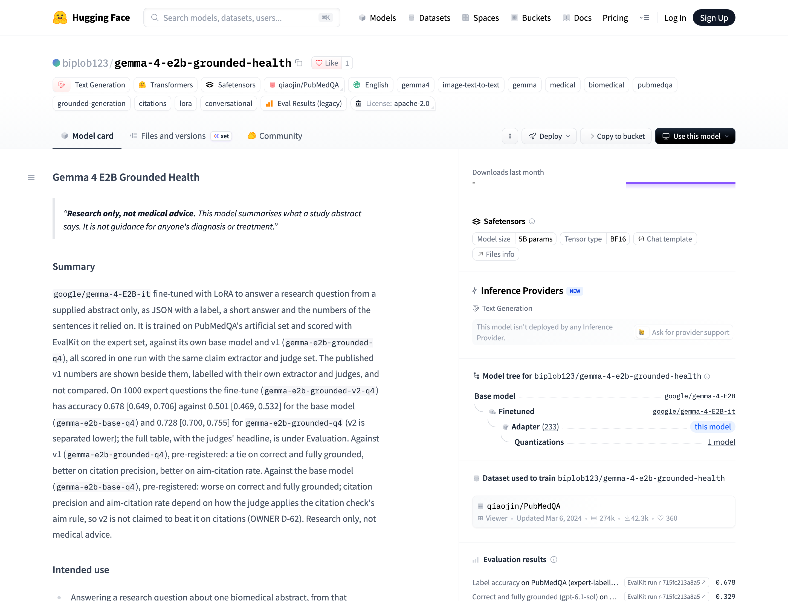
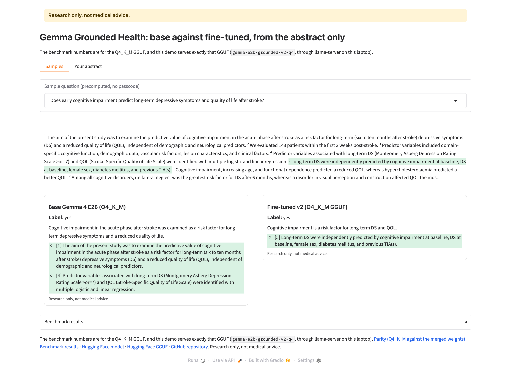
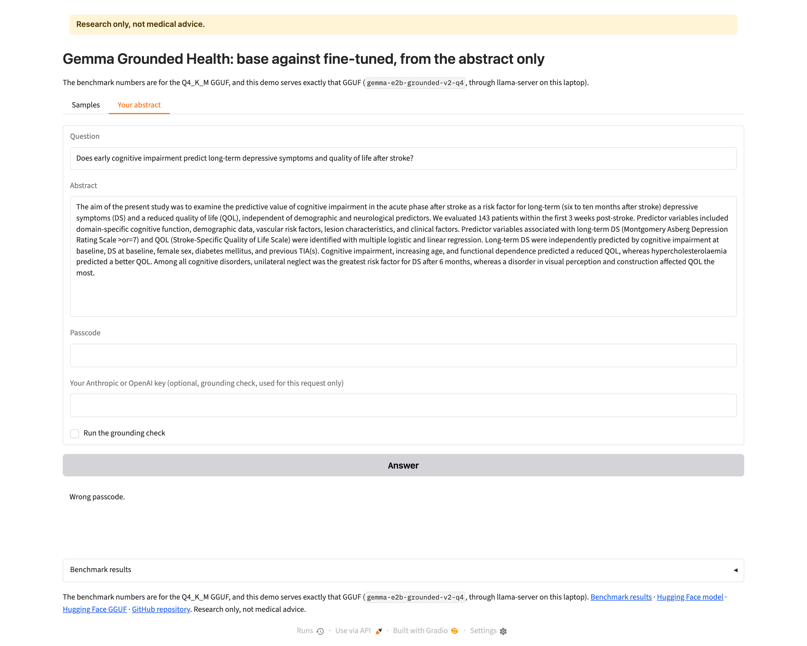
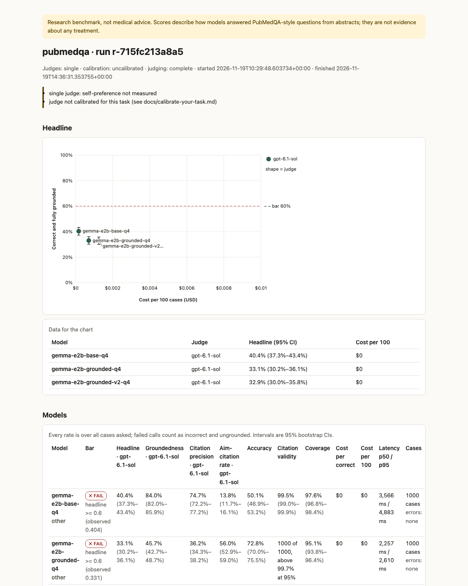

# Gemma Grounded Health

> **Research only, not medical advice.** The model summarises what a study abstract says. It is not guidance for anyone's diagnosis or treatment, and it is not for clinical use.

This project fine-tunes a small open Gemma model (Gemma 4 E2B with LoRA; its 4-bit GGUF runs offline on a laptop) to answer health research questions **only from a given abstract**, as JSON with a yes / no / maybe label, a short answer and the numbered sentences it relied on. Every model is scored with [EvalKit](https://github.com/biplob819/evalkit) on all 1,000 expert-labelled PubMedQA questions.

> **Status.** v1.0.0: v2 is released on Hugging Face ([model](https://huggingface.co/biplob123/gemma-4-e2b-grounded-health), [GGUF](https://huggingface.co/biplob123/gemma-4-e2b-grounded-health-GGUF)), with a passcode-gated local demo, the EvalKit report and a [reproduce-from-scratch guide](docs/reproduce.md). [Release notes](docs/release_notes_v1.0.0.md) · [Known issues](docs/known-issues.md).

**Contents:** [v2 result](#v2-result-the-citations-are-fixed-the-headline-is-not) · [Results](#results) · [Run it offline](#run-it-offline) · [Step-by-step guide](#step-by-step-guide) · [Screenshots](#screenshots) · [Links](#links) · [How it was built](#how-it-was-built) · [Licence and credits](#licence-and-credits)

## v2 result: the citations are fixed, the headline is not


v1 cited the study's aim instead of its results in more than half its answers, so it lost to its own base model on "correct and fully grounded". v2 was retrained on targets whose citations must each support the answer (OWNER D-43, D-48). On the same 1,000 questions, under a plan hashed before the run (`configs/eval_plan_v2.yaml`, OWNER D-53, D-57), the generated table under [Results](#results) gives:

- **v2 vs v1:** citation precision +0.374 and aim-citation rate −0.476, both separated; headline −0.002, a tie.
- **v2 vs base:** headline −0.075, separated (base better). On citations the pre-registered tests give aim-citation rate −0.054, separated in v2's favour, and citation precision a tie, but these depend on how the judge reads base's many answers that only restate the study's aim: the citation check marks the aim sentence as not supporting even when the claim is the aim itself. Counted the other way (a post-hoc check, [`aim_rule_check.json`](docs/measurements/aim_rule_check.json)), base is better than v2 on both. So v2 does not beat base on citations; it comes close to base's citation quality (within about 0.05 on either count) while v1 did not (OWNER D-62).
- Six pre-registered tests, paired bootstrap, Holm-corrected. The v2-vs-v1 results hold under either count. About half of v2's claims still go beyond the sentence it cites, which is why the headline did not move.
- **How it was scored:** GPT-6 Luna extracted claims and GPT-6.1 Sol judged them (OWNER D-57: the Anthropic API credit ran out, so V2.2 ran on OpenAI only). Base and v1 answers come from EvalKit's cache, byte-identical to the v1 run, and were re-scored the same way. Sol's agreement with a Claude Opus 5.5 reference labeller is kappa 0.598 [0.468, 0.711] on held-out claims (OWNER D-59, D-60; the labels are a model's, not a human expert's).


The full story, including how the v1 failure was found: [case study](docs/case-study.md).

## Results

Generated from the [results bundle](docs/results/results_bundle.json) by `uv run ggh readme-table --write README.md`; nothing between the markers is typed by hand (D-20).

<!-- ggh:results:start (generated by `ggh readme-table`; do not edit) -->
v2 on 1000 expert-labelled PubMedQA questions (EvalKit run `r-715fc213a8a5`, claims extracted by `gpt-6-luna`, judged by `gpt-6.1-sol` alone, calibration of v2: calibrated); every model in this table was scored in that run. 95% intervals in square brackets:

| Model | n | Accuracy | Correct and grounded (gpt-6.1-sol) | Citation precision (gpt-6.1-sol) | Aim-citation rate (gpt-6.1-sol, lower is better) |
|---|---|---|---|---|---|
| gemma-e2b-base-q4 | 1000 | 0.501 [0.469, 0.532] | 0.404 [0.373, 0.434] | 0.747 [0.722, 0.772] | 0.138 [0.117, 0.161] |
| gemma-e2b-grounded-q4 | 1000 | 0.728 [0.700, 0.755] | 0.331 [0.302, 0.361] | 0.362 [0.343, 0.382] | 0.560 [0.529, 0.590] |
| **gemma-e2b-grounded-v2-q4** | 1000 | 0.678 [0.649, 0.706] | 0.329 [0.300, 0.358] | 0.736 [0.708, 0.763] | 0.084 [0.067, 0.102] |

#### Published v1 numbers (not compared with v2)

These are v1's numbers as published under `configs/eval_plan.yaml`; they stand as they are and are shown for reference, not as a v2 comparison. They were produced with a different claim extractor and a different judge set from v2's run (claims extracted by `gpt-6-luna`, judged by `gpt-6.1-sol` alone), so the two sets of numbers are not comparable. As answering models, `claude-haiku-5-5` and `gpt-6-luna` were not re-scored for v2, so v2 is not compared with them. `gemma-e2b-base-q4` and `gemma-e2b-grounded-q4` appear in both v2's table and here; each table's numbers come from its own run.

Run `main` (`r-f0f3b432a413`), claims extracted by `claude-haiku-5-5`, judged by `claude-opus-5-5` and `gpt-6.1-sol`:

| Model | n | Accuracy | Correct and grounded (claude-opus-5-5) | Correct and grounded (gpt-6.1-sol) |
|---|---|---|---|---|
| gemma-e2b-base-q4 | 1000 | 0.501 [0.469, 0.532] | 0.418 [0.387, 0.448] | 0.394 [0.364, 0.424] |
| **gemma-e2b-grounded-q4** | 1000 | 0.728 [0.700, 0.755] | 0.388 [0.358, 0.419] | 0.330 [0.301, 0.359] |
| claude-haiku-5-5 | 1000 | 0.685 [0.656, 0.714] | 0.345 [0.316, 0.374] | 0.231 [0.205, 0.257] |
| gpt-6-luna | 1000 | 0.579 [0.548, 0.611] | 0.431 [0.401, 0.462] | 0.290 [0.262, 0.319] |

Run `main_citation` (`r-edfcba37159e`), claims extracted by `claude-haiku-5-5`, judged by `claude-opus-5-5` and `gpt-6.1-sol`:

| Model | n | Accuracy | Correct and grounded (claude-opus-5-5) | Correct and grounded (gpt-6.1-sol) | Citation precision (claude-opus-5-5) | Citation precision (gpt-6.1-sol) | Aim-citation rate (claude-opus-5-5, lower is better) | Aim-citation rate (gpt-6.1-sol, lower is better) |
|---|---|---|---|---|---|---|---|---|
| gemma-e2b-base-q4 | 1000 | 0.501 [0.469, 0.532] | 0.418 [0.387, 0.448] | 0.394 [0.364, 0.424] | 0.725 [0.698, 0.752] | 0.746 [0.721, 0.771] | 0.057 [0.043, 0.072] | 0.142 [0.120, 0.164] |
| **gemma-e2b-grounded-q4** | 1000 | 0.728 [0.700, 0.755] | 0.388 [0.358, 0.419] | 0.330 [0.301, 0.359] | 0.338 [0.319, 0.357] | 0.359 [0.340, 0.379] | 0.557 [0.525, 0.588] | 0.567 [0.536, 0.598] |
| claude-haiku-5-5 | 1000 | 0.685 [0.656, 0.714] | 0.345 [0.316, 0.374] | 0.231 [0.205, 0.257] | 0.848 [0.836, 0.860] | 0.882 [0.872, 0.893] | 0.186 [0.162, 0.210] | 0.225 [0.199, 0.251] |
| gpt-6-luna | 1000 | 0.579 [0.548, 0.611] | 0.431 [0.401, 0.462] | 0.290 [0.262, 0.319] | 0.865 [0.851, 0.879] | 0.894 [0.881, 0.905] | 0.094 [0.076, 0.113] | 0.116 [0.096, 0.136] |

Caveats: single judge: self-preference not measured; gpt-6.1-sol: calibrated, held-out kappa 0.598 [0.468, 0.711] on 231 pubmedqa claims, lower bound at least 0.4 (OWNER D-59): agreement with a Claude Opus 5.5 reference labeller (a model's labels, not a human expert's; OWNER D-60). Gemma-family check (40 claims from main_v2): agreement 0.950, kappa 0.893 [0.722, 1.000]; EvalKit's own run summaries keep its per-run stamp (OWNER D-59); B5 and B8 are a blind review by Claude Opus 5.5, not the owner (OWNER D-61); v2-vs-base citation results depend on how the judge applies the citation check's aim rule; a post-hoc count makes base better than v2 on citation precision and aim-citation rate, so v2 is not claimed to beat base on citations, while v2-vs-v1 holds under both counts (OWNER D-62, `docs/measurements/aim_rule_check.json`). The local demo serves the benchmarked Q4_K_M GGUF (OWNER D-63); the published bf16 weights agree with it on the label for 0.920 of 500 dev prompts. On a laptop (Apple M3 Max) the Q4_K_M GGUF generates 73.1 tokens/s (p50). Research only, not medical advice.
<!-- ggh:results:end -->

## Run it offline

Three lines with [Ollama](https://ollama.com/) (thinking off, as in the benchmark):

```bash
ollama pull hf.co/biplob123/gemma-4-e2b-grounded-health-GGUF:Q4_K_M
ollama run --think=false hf.co/biplob123/gemma-4-e2b-grounded-health-GGUF:Q4_K_M
# paste EvalKit's PubMedQA prompt: the question, then the abstract's sentences as [1] ..., [2] ...
```

The model answers as JSON only with that prompt; the [model card's "How to use"](MODEL_CARD.md#how-to-use) shows it in full. Ollama samples by default, so an answer can differ from the benchmark's greedy one; for greedy decoding use llama.cpp's `llama-server` as below.

## Step-by-step guide

### 1. Install

```bash
git clone https://github.com/biplob819/gemma-grounded-health
cd gemma-grounded-health
uv sync
uv run ggh doctor
```

You need Python 3.11+ and [uv](https://docs.astral.sh/uv/). `ggh doctor` lists which credentials are set (by name only); none is needed to run the model, the demo or the tests.

### 2. Run the model with llama.cpp (greedy, as benchmarked)

```bash
uv run hf download biplob123/gemma-4-e2b-grounded-health-GGUF gemma-4-e2b-grounded-health-Q4_K_M.gguf --local-dir artifacts/gguf
mv artifacts/gguf/gemma-4-e2b-grounded-health-Q4_K_M.gguf artifacts/gguf/ft2-Q4_K_M.gguf
uv run ggh llama fetch
uv run ggh serve --model ft2
```

`ggh llama fetch` downloads and verifies the pinned llama.cpp release; `ggh serve --model ft2` starts `llama-server` with v2's Q4_K_M on `http://127.0.0.1:8083` (greedy, thinking off). Send EvalKit's PubMedQA prompt to `/v1/chat/completions`.

### 3. Use the demo locally, with a passcode

The demo is a local app (OWNER D-63: no hosted GPU Space), recorded below. With `ggh serve --model ft2` running:

```bash
uv run ggh passkey set
uv run --group demo ggh space --local --env-file .env
```

`ggh passkey set` asks for a numeric passcode twice and prints its salted hash; put it in `.env` as `GGH_SPACE_PASSKEY=<hash>` (`.env` is gitignored, and the app reads only that key from it). Open `http://127.0.0.1:7860/`: the six sample questions work without a passcode; answers on your own abstract need it. An Anthropic or OpenAI key you paste pays for the optional grounding check for that one request and never replaces the passcode (OWNER D-36).


### 4. Reproduce from scratch

[docs/reproduce.md](docs/reproduce.md) gives every step as a real command: data, targets and the hand audit, training on Kaggle, export and parity, the EvalKit runs, the laptop benchmark, the results bundle, the cards and the release dry run. A test runs each step that needs no GPU, network or spend, and checks that the others parse.

### 5. Check a clean clone

```bash
uv run python scripts/fresh_clone_check.py
```

Clones this checkout at `HEAD` into a temporary folder and runs `uv run ggh doctor` and a fast test subset there. The full CI (`make check`: ruff, pyright, pytest, the secret scan, the graph check and the package build) runs on GitHub on every push.

## Screenshots

All taken from the real release, not mock-ups.

**The model on Hugging Face** (merged bf16 weights, the LoRA adapter, the card generated from the bundle; the GGUF repo holds the Q4_K_M and Q8_0 files):



**The local demo**, answering a sample question (left: base cites the study's aim; right: v2 cites the result sentence, highlighted in the abstract):



**The passcode gate**: a live answer on your own abstract with a wrong passcode is refused:



**The EvalKit report** for the V2.2 main run (published as EvalKit's [`/gemma/` page](https://biplob819.github.io/evalkit/gemma/), from [EvalKit PR #1](https://github.com/biplob819/evalkit/pull/1)):



**A walkthrough** of the project in real screens (results, the v1 citation failure, the Hugging Face page, the demo, the laptop benchmark, the CLI and the audit page; [shot list](docs/walkthrough.md)):

[](https://github.com/biplob819/gemma-grounded-health/blob/main/docs/walkthrough.md)

## Links

Generated from `ggh.release.links` (OWNER D-37); `tests/release/test_links.py` checks every link offline.

<!-- ggh:links:start (generated by `ggh readme-table`; do not edit) -->
- [GitHub repository](https://github.com/biplob819/gemma-grounded-health)
- [GitHub release v1.0.0](https://github.com/biplob819/gemma-grounded-health/releases/tag/v1.0.0)
- [Hugging Face model](https://huggingface.co/biplob123/gemma-4-e2b-grounded-health)
- [Hugging Face GGUF](https://huggingface.co/biplob123/gemma-4-e2b-grounded-health-GGUF)
- [Demo (local, recorded; OWNER D-63)](docs/assets/demo.gif)
- [EvalKit report page](https://biplob819.github.io/evalkit/gemma/)
- [EvalKit upstream pull request](https://github.com/biplob819/evalkit/pull/1)
- [Parity (Q4_K_M against the merged weights)](https://github.com/biplob819/gemma-grounded-health/blob/main/docs/measurements/v2/parity.json)
- [Benchmark results](https://github.com/biplob819/gemma-grounded-health/tree/main/docs/results)
- [DATA_CARD.md](DATA_CARD.md)
- [MODEL_CARD.md](MODEL_CARD.md)
- [PRD](Gemma%20Grounded%20Health%20PRD.md)
- [Tech Spec](Gemma%20Grounded%20Health%20Tech%20Spec.md)
- [Results bundle](docs/results/results_bundle.json)
- [CITATION.cff](CITATION.cff)
- [Write-up](docs/writeup/how-i-built-it.md)
- [Case study: the v1 grounding failure](docs/case-study.md)
- [Reproduce from scratch](docs/reproduce.md)
- [Release notes v1.0.0](docs/release_notes_v1.0.0.md)
- [Known issues](docs/known-issues.md)
- [EvalKit](https://github.com/biplob819/evalkit)
<!-- ggh:links:end -->

## How it was built

The project is built node by node with the same harness as EvalKit: a dependency-gated build graph (`docs/graph/`), a capability catalog with proof cells, converge gates (`scripts/node_converge.py`) and a skeptical verifier (Tech Spec §13). Build status: `uv run python scripts/status.py`. Decisions: [docs/decisions.md](docs/decisions.md) and the [Tech Spec](Gemma%20Grounded%20Health%20Tech%20Spec.md) §1; what it is for: the [PRD](Gemma%20Grounded%20Health%20PRD.md); what was learned: [docs/lessons.md](docs/lessons.md).

Contributions welcome: [CONTRIBUTING.md](CONTRIBUTING.md) · [Code of conduct](CODE_OF_CONDUCT.md) · [Security](SECURITY.md) · [Report a bug or a model behaviour](.github/ISSUE_TEMPLATE) · [Pull request checklist](.github/PULL_REQUEST_TEMPLATE.md).

## Licence and credits

Code and weights: Apache-2.0, see [LICENSE](LICENSE) and [NOTICE](NOTICE). Base model: Gemma 4 E2B (Apache-2.0). Data: [PubMedQA](https://pubmedqa.github.io/) (Jin et al., 2019, MIT licence). Cite with [CITATION.cff](CITATION.cff). Research only, not medical advice.
