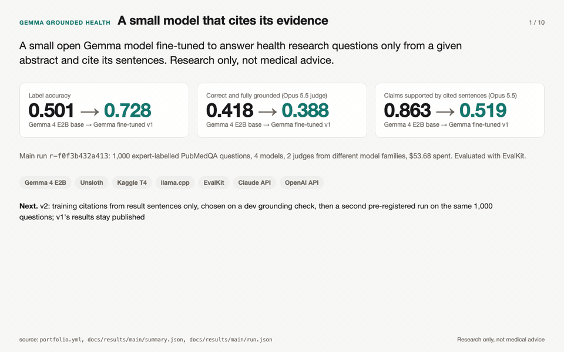

# Gemma Grounded Health

This project fine-tunes a small open Gemma model (Gemma 4 E2B, 3.3 GB at 4-bit, runs offline on a laptop) to answer health research questions **only from a given abstract**, with a yes / no / maybe label, a short answer and the numbered sentences it relied on. Every model is scored with [EvalKit](https://github.com/biplob819/evalkit) on all 1,000 expert-labelled PubMedQA questions, against its own base model, Claude Haiku 5.5 and GPT-6 Luna, with two judges from different model families.

> **Status.** v1 is trained and measured; v2 is trained and passed its dev citation bars, and its test run is next (build node V2.2), then the Hugging Face release with the recipe, a laptop GGUF and a demo (nodes R4.2 and R4.3). Research only, not medical advice.

| v1 main run (`r-f0f3b432a413`, 1,000 questions) | Label accuracy | Correct and fully grounded (Opus / Sol) |
| --- | --- | --- |
| Gemma base | 0.501 | 0.418 / 0.394 |
| **Gemma fine-tuned (v1)** | **0.728** | 0.388 / 0.330 |
| Claude Haiku 5.5 | 0.685 | 0.345 / 0.231 |
| GPT-6 Luna | 0.579 | 0.431 / 0.290 |

v1 raised label accuracy by 22.7 points but did not beat its base on the pre-registered headline, because its citations often pointed at the study's aim instead of its results. v2 retrains on targets that never cite an aim sentence. On 200 dev questions (GPT-6.1 Sol judging) v2's citation precision is 0.768 (v1 0.404) and its aim-citation rate 0.067 (v1 0.590); its headline (0.350 against v1's 0.355; under Opus, 0.440–0.445 against 0.465) and label accuracy (0.795 against a 0.80 bar) narrowly missed their dev bars, disclosed in [known issues](docs/known-issues.md). The full story: [case study](docs/case-study.md). Results: `docs/results/`.

- Product: [Gemma Grounded Health PRD](Gemma%20Grounded%20Health%20PRD.md)
- Design: [Gemma Grounded Health Tech Spec](Gemma%20Grounded%20Health%20Tech%20Spec.md)
- Build status: `uv run python scripts/status.py`

The project is built node by node with the same harness as EvalKit: a dependency-gated build graph (`docs/graph/`), a capability catalog with proof cells, converge gates (`scripts/node_converge.py`) and a skeptical verifier. See Tech Spec §13.

Contributions welcome: [CONTRIBUTING.md](CONTRIBUTING.md) · [Code of conduct](CODE_OF_CONDUCT.md) · [Security](SECURITY.md) · [Report a bug or a model behaviour](.github/ISSUE_TEMPLATE) · [Pull request checklist](.github/PULL_REQUEST_TEMPLATE.md) · Cite with [CITATION.cff](CITATION.cff).

Data: [PubMedQA](https://pubmedqa.github.io/) (Jin et al., 2019, MIT licence). Base model: Gemma 4 E2B (Apache-2.0). Code: Apache-2.0, see [LICENSE](LICENSE) and [NOTICE](NOTICE); the model will be released under Apache-2.0 too (node R4.2).
