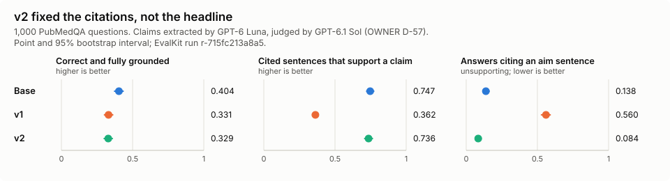
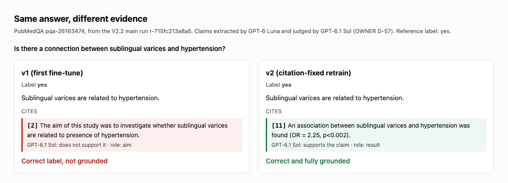

# Gemma Grounded Health

<!-- generated by `ggh writeup` from the results bundle and committed evidence; edit src/ggh/release/templates/writeup/project_page.md, not this file -->

> **Research only, not medical advice.** The model summarises what a study abstract says. It is not guidance for anyone's diagnosis or treatment.

A small open model, Gemma 4 E2B with LoRA, fine-tuned to answer a health research question only from the abstract it is given: a yes, no or maybe label, a short answer and the numbers of the sentences it relied on. Its Q4_K_M GGUF runs offline on a laptop. Every model is scored with EvalKit on all 1,000 expert-labelled PubMedQA questions.



## The result in one paragraph

The first fine-tune (v1) learned the label, raising accuracy from 0.501 to 0.728, but cited the study's aim instead of its results, so it lost to its own base model on "correct and fully grounded". The retrain (v2) fixed the citations against v1 (citation precision +0.374 [0.344, 0.403], separated, v2 better; aim-citation rate −0.476 [−0.508, −0.443], separated, v2 better). It did not move the headline against v1 (−0.002 [−0.034, 0.030], a tie), and the base model is still better on it (−0.075 [−0.113, −0.037], separated, base better).

## Results

From the pre-registered v2 run, scored by GPT-6 Luna (claims) and GPT-6.1 Sol (judge):

| Model | n | Accuracy | Correct and grounded (gpt-6.1-sol) | Citation precision (gpt-6.1-sol) | Aim-citation rate (gpt-6.1-sol, lower is better) |
|---|---|---|---|---|---|
| gemma-e2b-base-q4 | 1000 | 0.501 [0.469, 0.532] | 0.404 [0.373, 0.434] | 0.747 [0.722, 0.772] | 0.138 [0.117, 0.161] |
| gemma-e2b-grounded-q4 | 1000 | 0.728 [0.700, 0.755] | 0.331 [0.302, 0.361] | 0.362 [0.343, 0.382] | 0.560 [0.529, 0.590] |
| **gemma-e2b-grounded-v2-q4** | 1000 | 0.678 [0.649, 0.706] | 0.329 [0.300, 0.358] | 0.736 [0.708, 0.763] | 0.084 [0.067, 0.102] |

## What failed, and what changed

- **v1's citations pointed at the aim.** Under GPT-6.1 Sol, 0.560 of v1's answers cite an aim sentence that does not support the claim; base: 0.138. Training targets had picked citations by word overlap with the author's conclusion, and the study's aim shares most of its words with the conclusion.
- **v2 cites what supports the answer.** Its targets cite only sentences that each support the answer on their own (OWNER D-43, D-48); its aim-citation rate is 0.084.
- **The headline did not follow.** On average 0.493 of v2's claims are judged supported; many still go beyond the sentence they cite.



## Offline on a laptop

On an Apple M3 Max the Q4_K_M file (3269.1 MB) generates 73.1 tokens a second and answers in 840 ms (medians), peaking at 4506.6 MB of memory. Run it with Ollama, thinking off:

```bash
ollama run --think=false hf.co/biplob123/gemma-4-e2b-grounded-health-GGUF:Q4_K_M
```

The demo is a local app against the same benchmarked file, behind a passcode (OWNER D-63):


## Caveats

- gpt-6.1-sol: calibrated, held-out kappa 0.598 [0.468, 0.711] on 231 pubmedqa claims, lower bound at least 0.4 (OWNER D-59): agreement with a Claude Opus 5.5 reference labeller (a model's labels, not a human expert's; OWNER D-60). Gemma-family check (40 claims from main_v2): agreement 0.950, kappa 0.893 [0.722, 1.000].
- EvalKit's own run summaries keep its per-run stamp (OWNER D-59).
- B5 and B8 are a blind review by Claude Opus 5.5, not the owner (OWNER D-61).
- v2-vs-base citation results depend on how the judge applies the citation check's aim rule; a post-hoc count makes base better than v2 on citation precision and aim-citation rate, so v2 is not claimed to beat base on citations, while v2-vs-v1 holds under both counts (OWNER D-62, `docs/measurements/aim_rule_check.json`).

## Read more

- [How I built it](how-i-built-it.md): the harness, the data, training, the v1 failure, the v2 retrain and every caveat.
- [Decisions that shaped the result](decisions-summary.md) and the [one-page PRD summary](prd-one-page.md).
- [Video script](video-script.md).

- [GitHub repository](https://github.com/biplob819/gemma-grounded-health)
- [GitHub release v1.0.0](https://github.com/biplob819/gemma-grounded-health/releases/tag/v1.0.0)
- [Hugging Face model](https://huggingface.co/biplob123/gemma-4-e2b-grounded-health)
- [Hugging Face GGUF](https://huggingface.co/biplob123/gemma-4-e2b-grounded-health-GGUF)
- [Demo (local, recorded; OWNER D-63)](../../docs/assets/demo.gif)
- [EvalKit report page](https://biplob819.github.io/evalkit/gemma/)
- [EvalKit upstream pull request](https://github.com/biplob819/evalkit/pull/1)
- [Parity (Q4_K_M against the merged weights)](https://github.com/biplob819/gemma-grounded-health/blob/main/docs/measurements/v2/parity.json)
- [Benchmark results](https://github.com/biplob819/gemma-grounded-health/tree/main/docs/results)
- [DATA_CARD.md](../../DATA_CARD.md)
- [MODEL_CARD.md](../../MODEL_CARD.md)
- [PRD](../../Gemma%20Grounded%20Health%20PRD.md)
- [Tech Spec](../../Gemma%20Grounded%20Health%20Tech%20Spec.md)
- [Results bundle](../../docs/results/results_bundle.json)
- [CITATION.cff](../../CITATION.cff)
- [Case study: the v1 grounding failure](../../docs/case-study.md)
- [Reproduce from scratch](../../docs/reproduce.md)
- [Release notes v1.0.0](../../docs/release_notes_v1.0.0.md)
- [Known issues](../../docs/known-issues.md)
- [EvalKit](https://github.com/biplob819/evalkit)
